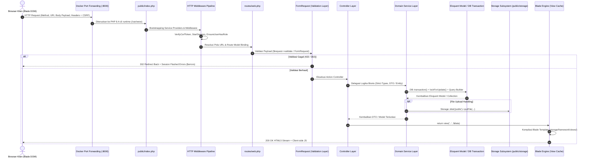

# 00. MASTER TRACEABILITY MATRIX & GLOBAL ARCHITECTURE
**Sistem Reservasi Fasilitas & Pelaporan Kendala Sarpras Kampus (Resvi)**  
*Workspace:* `/home/rafrusth/Attic/Programming/PPK/PPK-Room-Reservation`  
*Kerangka Kerja:* Laravel 13 (PHP 8.4-cli) | MySQL 8.0 | Docker Compose

---

## 1. Topologi Kontainer & Isolasi Lingkungan (*Docker Container Topology*)

Aplikasi Resvi beroperasi di dalam topologi 3 kontainer terisolasi yang diorkestrasi melalui `docker-compose.yml`:

```
+----------------------------------------------------------------------------------+
|                                  HOST MACHINE                                    |
|   Peramban Web Klien  <---> [0.0.0.0:8000]       [0.0.0.0:3306]   [0.0.0.0:8080]  |
+----------------------------------+---------------------+----------------+--------+
                                   |                     |                |
                       Bridge Port Forwarding            |                |
                                   |                     |                |
+----------------------------------v---------------------v----------------v--------+
| DOCKER BRIDGE NETWORK: ppk_network                                               |
|                                                                                  |
|  +--------------------------------------------------+                            |
|  | [ppk_app] (PHP 8.4-cli + Laravel 13)             |                            |
|  | - Port: 8000:8000                                |                            |
|  | - Volume: .:/var/www (Bind Mount)                |                            |
|  | - Working Dir: /var/www                          |                            |
|  | - Run-time Startup Symlink:                      |                            |
|  |   ln -sfn ../storage/app/public public/storage   |                            |
|  |   && php artisan serve --host=0.0.0.0            |                            |
|  +-------------------------+------------------------+                            |
|                            | TCP: db:3306                                        |
|  +-------------------------v------------------------+  +----------------------+  |
|  | [ppk_db] (MySQL 8.0)                             |  | [ppk_phpmyadmin]     |  |
|  | - Port: 3306:3306                                |  | - Port: 8080:80      |  |
|  | - Database: ppk_room_reservation                 |  | - PMA_HOST: db       |  |
|  | - Volume: mysql_data                             |  +----------------------+  |
|  | - Healthcheck: mysqladmin ping                   |                            |
|  +--------------------------------------------------+                            |
+----------------------------------------------------------------------------------+
```

> [!IMPORTANT]
> **Zero Host Execution Rule:**  
> Tidak ada utilitas host (`php`, `composer`, `mysql`) yang dijalankan secara langsung. Seluruh operasi wajib diarahkan ke dalam kontainer:
> ```bash
> docker compose exec app php artisan <perintah>
> docker compose exec app composer <perintah>
> ```

---

## 2. Diagram Rantai Eksekusi End-to-End (*Macro Request-Response Lifecycle*)



---

## 3. Master Traceability Matrix: 17 User Stories (Lengkap)

| No | ID | Aktor | Deskripsi Kebutuhan Bisnis | Blade View Utama (`resources/views/`) | HTTP Verb & URI | Controller & Action | FormRequest / Validator | Domain Service Layer | Model, Tabel & Storage |
| :--- | :--- | :--- | :--- | :--- | :--- | :--- | :--- | :--- | :--- |
| 1 | **US-01** | Publik & Pengguna | Cek ketersediaan slot waktu fasilitas tanpa membocorkan identitas pemohon | `facilities/show.blade.php` | `POST /reservations/check-availability` | `ReservationFlowController::checkAvailability` | `CheckAvailabilityRequest` | `FacilityAvailabilityService::check` | `Facility`, `Reservation` (`reservations`) |
| 2 | **US-02** | Publik & Pengguna | Pencarian katalog fasilitas berdasarkan tipe, lokasi, dan kapasitas | `facilities/index.blade.php` | `GET /facilities` | `FacilityController::index` | `FacilityFilterRequest` | `FacilityCatalogService::getPaginatedFacilities` | `Facility`, `FacilityPhoto` (`facilities`) |
| 3 | **US-03** | Pengguna | Pengajuan reservasi pada rentang waktu tertentu dengan agenda kegiatan | `reservations/create.blade.php` | `POST /my/reservations` | `User\ReservationController::store` | `StoreReservationRequest` | `UserReservationService::createReservation` | `Reservation` (`reservations`) |
| 4 | **US-04** | Pengguna | Pembatalan reservasi mandiri sebelum batas waktu (*cutoff time*) | `user/reservations/show.blade.php` | `POST /my/reservations/{reservation}/cancel` | `User\ReservationController::cancel` | `CancelReservationRequest` | `UserReservationService::cancelReservation` | `Reservation` (`reservations`) |
| 5 | **US-05** | Pengguna | Riwayat, status, dan rincian lengkap reservasi personal | `user/reservations/index.blade.php` | `GET /my/reservations` | `User\ReservationController::index` | Guard kepemilikan data pengguna | `UserReservationService` | `Reservation` (`reservations`) |
| 6 | **US-06** | Pengguna | Pelaporan kerusakan sarpras (kategori enum, deskripsi, foto bukti multipart) | `user/reports/create.blade.php` | `POST /my/reports` | `User\ReportController::store` | `StoreReportRequest` | `UserReportService::createReport` | `Report` (`reports`), Disk: `public/reports` |
| 7 | **US-07** | Pengguna | Tracking progres pelaporan kendala beserta catatan resolusi resmi | `user/reports/index.blade.php` | `GET /my/reports` | `User\ReportController::index` | Guard kepemilikan data pelapor | `UserReportService` | `Report` (`reports`) |
| 8 | **US-08** | Petugas | Dashboard antrean reservasi & kendala aktif (Prioritas FIFO) | `staff/reservations/index.blade.php` | `GET /staff/reservations` | `Staff\ReservationController::index` | Query Filter Param (`search`, `type`, `status`) | `StaffReservationService::getActiveQueue` | `Reservation`, `Report` |
| 9 | **US-09** | Petugas | Persetujuan reservasi manual dengan pencegahan bentrok & auto-reject | `staff/reservations/show.blade.php` | `POST /staff/reservations/{reservation}/approve` | `Staff\ReservationController::approve` | Route Model Binding + Role Petugas | `StaffReservationService::approve` | `Reservation`, Lock For Update |
| 10 | **US-10** | Petugas | Pembatalan darurat reservasi disetujui (force majeure) berjustifikasi | `staff/reservations/partials/cancel-modal.blade.php` | `POST /staff/reservations/{reservation}/cancel` | `Staff\ReservationController::cancel` | `CancelUrgentReservationRequest` | `StaffReservationService::cancelUrgent` | `Reservation` (`reservations`) |
| 11 | **US-11** | Petugas | Disposisi laporan kendala (Baru $\rightarrow$ Diproses $\rightarrow$ Selesai / Ditolak) | `staff/reports/show.blade.php` | `POST /staff/reports/{report}/resolve` | `Staff\ReportController::resolve` | `ResolveReportRequest`, `RejectReportRequest` | `StaffReportService::resolve`, `reject` | `Report` (`reports`) |
| 12 | **US-12** | Petugas | Pengalihan status fasilitas ke 'Dalam Perbaikan' & pemulihan status | `staff/facilities/maintenance.blade.php` | `POST /staff/facilities/{facility}/update-status` | `Staff\FacilityController::updateStatus` | `UpdateOperationalStatusRequest` | `StaffFacilityService::updateOperationalStatus` | `Facility`, `FacilityStatusLog` |
| 13 | **US-13** | Admin | Pendaftaran akun Petugas langsung secara administratif | `admin/accounts/create.blade.php` | `POST /admin/accounts` | `Admin\AccountController::store` | `StoreAccountRequest` (`role:petugas`) | `AccountService::createAccount` | `User` (`users`) |
| 14 | **US-14** | Admin | Pendaftaran akun Pengguna (Mahasiswa/Dosen/Tendik) langsung | `admin/accounts/create.blade.php` | `POST /admin/accounts` | `Admin\AccountController::store` | `StoreAccountRequest` (`role:pengguna`) | `AccountService::createAccount` | `User` (`users`) |
| 15 | **US-15** | Admin | Verifikasi akun & reset kredensial langsung dengan pencatatan audit | `admin/accounts/partials/password-modal.blade.php` | `POST /admin/accounts/{user}/reset-password` | `Admin\AccountController::resetPassword` | `ResetPasswordRequest` | `AccountService::resetPassword` | `User` (`users`) |
| 16 | **US-16** | Admin | Master Fasilitas: CRUD, penonaktifan berguard, & reaktivasi | `admin/facilities/index.blade.php` | `PUT /admin/facilities/{facility}` | `Admin\FacilityController::update` | `StoreFacilityRequest`, `UpdateFacilityRequest` | `FacilityService::createFacility`, `deactivateFacility` | `Facility`, `FacilityPhoto`, Disk `public/facilities` |
| 17 | **US-17** | Admin | Rekapitulasi okupansi & frekuensi kerusakan (Ekspor CSV, Excel, PDF) | `admin/recaps/index.blade.php` | `GET /admin/recaps/export` | `Admin\RecapController::export` | `RecapFilterRequest` | `RecapService::exportPdf`, `exportCsv`, `exportExcel` | Agregasi SQL `Reservation`, `Report`, DomPDF |

---

## 4. Peta Modul Dokumentasi Terpisah

Seluruh modul telah diuraikan ke dalam berkas dokumentasi mandiri yang dapat diakses pada folder ini:

1. [`01_MODUL_1_PUBLIK_DAN_PENCARIAN.md`](file:///home/rafrusth/Attic/Programming/PPK/PPK-Room-Reservation/docs/code-defense/01_MODUL_1_PUBLIK_DAN_PENCARIAN.md) (US-01, US-02)
2. [`02_MODUL_2_SIKLUS_RESERVASI_PENGGUNA.md`](file:///home/rafrusth/Attic/Programming/PPK/PPK-Room-Reservation/docs/code-defense/02_MODUL_2_SIKLUS_RESERVASI_PENGGUNA.md) (US-03, US-04, US-05)
3. [`03_MODUL_3_PELAPORAN_KENDALA_SARPRAS.md`](file:///home/rafrusth/Attic/Programming/PPK/PPK-Room-Reservation/docs/code-defense/03_MODUL_3_PELAPORAN_KENDALA_SARPRAS.md) (US-06, US-07)
4. [`04_MODUL_4_TRIAGE_DAN_VERIFIKASI_PETUGAS.md`](file:///home/rafrusth/Attic/Programming/PPK/PPK-Room-Reservation/docs/code-defense/04_MODUL_4_TRIAGE_DAN_VERIFIKASI_PETUGAS.md) (US-08, US-09, US-10)
5. [`05_MODUL_5_PEMELIHARAAN_DAN_STATUS_FASILITAS.md`](file:///home/rafrusth/Attic/Programming/PPK/PPK-Room-Reservation/docs/code-defense/05_MODUL_5_PEMELIHARAAN_DAN_STATUS_FASILITAS.md) (US-11, US-12)
6. [`06_MODUL_6_TATA_KELOLA_AKUN_ADMIN.md`](file:///home/rafrusth/Attic/Programming/PPK/PPK-Room-Reservation/docs/code-defense/06_MODUL_6_TATA_KELOLA_AKUN_ADMIN.md) (US-13, US-14, US-15)
7. [`07_MODUL_7_MASTER_DATA_DAN_ANALYTICS.md`](file:///home/rafrusth/Attic/Programming/PPK/PPK-Room-Reservation/docs/code-defense/07_MODUL_7_MASTER_DATA_DAN_ANALYTICS.md) (US-16, US-17)
8. [`08_MODUL_8_ARSITEKTUR_DOCKER_DAN_STORAGE.md`](file:///home/rafrusth/Attic/Programming/PPK/PPK-Room-Reservation/docs/code-defense/08_MODUL_8_ARSITEKTUR_DOCKER_DAN_STORAGE.md) (Symlink engine, permissions, networking)

