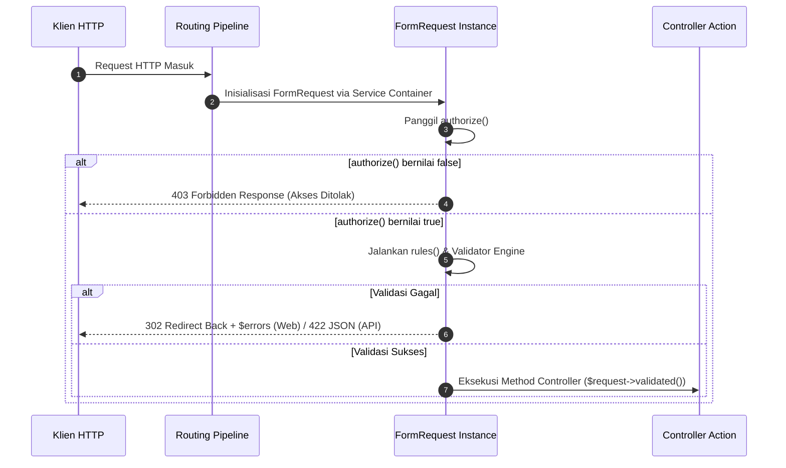

# 10. KAMUS SINTAKS & ENSIKLOPEDIA POLA HTTP LAYER (`app/Http/`)
**Panduan Persiapan Ujian Sidang Kode Baris-per-Baris (Oral Code Defense)**  
*Aplikasi:* Resvi (Sistem Reservasi Fasilitas & Pelaporan Kendala Sarpras Kampus)  
*Workspace:* `/home/rafrusth/Attic/Programming/PPK/PPK-Room-Reservation`  
*Fokus:* Controller Lifecycle, Dependency Injection, FormRequest Validation, Route Model Binding, HTTP Responses, & Middleware Pipeline

---

## DAFTAR ISI
1. [BAB 1: Arsitektur Controller, Injeksi Dependensi, & Konstruktor PHP 8.4](#bab-1-arsitektur-controller-injeksi-dependensi--konstruktor-php-84)
2. [BAB 2: Pola Respon HTTP & Komunikasi Lapisan Tampilan](#bab-2-pola-respon-http--komunikasi-lapisan-tampilan)
3. [BAB 3: Route Model Binding & Siklus Model di Controller](#bab-3-route-model-binding--siklus-model-di-controller)
4. [BAB 4: Penanganan Input, Request, & Unggah Berkas](#bab-4-penanganan-input-request--unggah-berkas)
5. [BAB 5: Arsitektur FormRequest Validation (`app/Http/Requests/`)](#bab-5-arsitektur-formrequest-validation-apphttprequests)
6. [BAB 6: Arsitektur Middleware (`app/Http/Middleware/EnsureUserHasRole.php`)](#bab-6-arsitektur-middleware-apphttpmiddlewareensureuserhasrolephp)
7. [BAB 7: Simulasi Ujian Sidang Khusus Lapisan HTTP & Controller (Oral Defense Grilling)](#bab-7-simulasi-ujian-sidang-khusus-lapisan-http--controller-oral-defense-grilling)

---

# BAB 1: ARSITEKTUR CONTROLLER, INJEKSI DEPENDENSI, & KONSTRUKTOR PHP 8.4

Lapisan controller pada aplikasi Resvi berada di `app/Http/Controllers/`. Controller bertindak sebagai orkestrator tipis (*thin controller*) yang menerima permintaan HTTP, mendelegasikannya ke domain service layer, dan mengembalikan respon.

### 1.1 Base Controller (`extends Controller`)
- **Bentuk Sintaks:**
  ```php
  namespace App\Http\Controllers\User;

  use App\Http\Controllers\Controller;

  class ReservationController extends Controller
  ```
- **Fungsi & Mekanisme Runtime:**  
  Setiap controller mewarisi kelas abstrak `App\Http\Controllers\Controller`. Kelas induk ini mengizinkan penggunaan helper internal framework (seperti otorisasi controller, middleware assignment di controller, dan validasi bawaan jika diperlukan).

---

### 1.2 Constructor Property Promotion & Readonly Properties (PHP 8.2 / 8.4)
- **Bentuk Sintaks Real (diambil dari `Staff/ReservationController.php` & `Admin/RecapController.php`):**
  ```php
  // Versi protected (Staff/ReservationController.php baris 16-18):
  public function __construct(
      protected StaffReservationService $reservationService
  ) {}

  // Versi private readonly (Admin/RecapController.php baris 14-16):
  public function __construct(
      private readonly RecapService $recapService,
  ) {}
  ```
- **Fungsi & Mekanisme Runtime:**  
  - **Constructor Property Promotion:** Fitur modern PHP yang menggabungkan deklarasi atribut kelas, parameter konstruktor, dan penugasan nilai (`$this->service = $service`) ke dalam satu baris deklarasi ringkas.
  - **`readonly` Keyword:** Menjamin bahwa referensi service bersifat *immutable* (tidak dapat diubah atau ditimpa setelah instansiasi kelas selesai).
- **Mekanisme Injeksi Dependensi (Automatic Dependency Injection):**  
  Ketika route memanggil Controller, **Laravel Service Container (IoC Container)** secara otomatis memeriksa *type-hint* parameter di konstruktor menggunakan mekanisme PHP Reflection. Service Container menginstansiasi objek `StaffReservationService` beserta seluruh dependensinya (seperti `FacilityAvailabilityService`) dan menyuntikkannya ke controller tanpa perlu instansiasi manual `new Service()`.
- **Justifikasi Pertahanan Sidang:**  
  Menerapkan prinsip **Inversion of Control (IoC)** dan **Single Responsibility Principle (SRP)**. Controller tidak bertanggung jawab atas pembuatan objek dependensinya sendiri, melainkan menerima dependensi dari container sehingga memudahkan pembuatan mock objek saat pengujian otomatis (*Unit Testing*).

---

### 1.3 Arsitektur Thin Controller & Domain Service Delegation
- **Bentuk Sintaks Real (diambil dari `User/ReservationController.php` baris 57–67):**
  ```php
  public function store(StoreReservationRequest $request): RedirectResponse
  {
      $reservation = $this->reservationService->createReservation(
          user: $request->user(),
          data: $request->validated()
      );

      return redirect()
          ->route('user.reservations.index', ['as_user' => 1])
          ->with('success', "Reservasi #{$reservation->reservation_number} berhasil diajukan...");
  }
  ```
- **Justifikasi Pertahanan Sidang:**  
  *Mengapa logika tidak ditulis langsung di dalam controller?*  
  Jika seluruh query SQL, validasi ketersediaan waktu, penguncian baris `lockForUpdate()`, dan transaksi `DB::transaction` ditulis di controller, controller menjadi gemuk (*Fat Controller*), sulit diuji, dan kodenya tidak dapat digunakan kembali (*code duplication*) jika fitur yang sama dipanggil melalui CLI Command atau REST API di masa depan. Controller bertugas murni sebagai pengatur lalu lintas HTTP (*Traffic Director*).

---

# BAB 2: POLA RESPON HTTP & KOMUNIKASI LAPISAN TAMPILAN

Controller di Resvi menghasilkan berbagai macam tipe respon HTTP tergantung pada kebutuhan klien:

---

### 2.1 `view('...', [...])` vs `view('...', compact(...))`
- **Bentuk Sintaks Array Eksplisit (diambil dari `User/ReservationController.php` baris 32–34):**
  ```php
  return view('user.reservations.index', [
      'reservations' => $reservations,
  ]);
  ```
- **Bentuk Sintaks `compact()` (diambil dari `Staff/ReservationController.php` baris 31 & 56):**
  ```php
  return view('staff.reservations.index', compact('reservations'));
  return view('staff.reservations.show', compact('reservation'));
  ```
- **Dekonstruksi Teknis `compact()`:**  
  - `compact('reservations')` adalah fungsi native bawaan PHP yang membaca string nama variabel dalam cakupan lokal (*local variable scope*) dan mengonversinya menjadi array asosiatif: `['reservations' => $reservations]`.
- **Perbandingan & Pertahanan Sidang:**  
  - `compact()` lebih ringkas untuk meneruskan 1 atau 2 variabel yang nama variabel dan kuncinya identik.
  - Array eksplisit `['key' => $val]` lebih disukai ketika kita ingin mengubah nama kunci untuk View, memberikan nilai default, atau melakukan sanitasi tipe data sebelum masuk ke template.
  - *Risiko `compact()`:* Jika terjadi typo pada string `compact('reservatoin')`, PHP tidak melempar error kompilasi melainkan warning di runtime bahwa variabel tersebut tidak ditemukan.

---

### 2.2 `redirect()->route(...)` & Chaining `->with(...)` (Flash Session Data)
- **Bentuk Sintaks Real (diambil dari `Staff/ReservationController.php` baris 66–67):**
  ```php
  return redirect()->route('staff.reservations.index')
      ->with('success', "Permohonan reservasi #{$reservation->reservation_number} berhasil disetujui.");
  ```
- **Bentuk Sintaks Status & Warning (diambil dari `Admin/FacilityController.php` baris 67–68):**
  ```php
  return redirect()->route('admin.facilities.index')
      ->with('status', sprintf('Fasilitas "%s" berhasil ditambahkan.', $facility->name));
  ```
- **Fungsi & Mekanisme Runtime:**  
  1. `redirect()->route('...')` mengembalikan instans `Illuminate\Http\RedirectResponse` dengan kode status **HTTP 302 Found** dan header `Location: http://.../staff/reservations`.
  2. Metode `->with('key', 'value')` menyimpan data pesan ke dalam **Flash Session** (disimpan di file session server `storage/framework/sessions/` atau memori). Data ini bertahan tepat selama 1 siklus HTTP berikutnya, lalu otomatis dihancurkan setelah dirender oleh `@if(session('success'))` di Blade View.
  3. Pola ini menerapkan standar arsitektur web **Post/Redirect/Get (PRG)** untuk mencegah pengguna mengirim ulang formulir secara tidak sengaja (*form resubmission on page refresh*).

---

### 2.3 `redirect()->intended(...)` & Deep-Linking Authentication
- **Bentuk Sintaks Real (diambil dari `Auth/AuthenticatedSessionController.php` baris 51–59):**
  ```php
  if ($user?->isAdmin()) {
      return redirect()->intended(route('admin.facilities.index'));
  }

  if ($user?->role === UserRole::Petugas) {
      return redirect()->intended(route('staff.reservations.index'));
  }

  return redirect()->intended(route('home'));
  ```
- **Fungsi & Mekanisme Runtime:**  
  - Ketika pengguna yang belum login mencoba mengakses halaman terproteksi (misal `/staff/reservations`), middleware `EnsureUserHasRole` memanggil `redirect()->guest(route('login'))`. Laravel otomatis menyimpan URL asal tersebut ke session dengan kunci `url.intended`.
  - Setelah login berhasil, `redirect()->intended($fallbackUrl)` memeriksa apakah ada URL asal di session. Jika ada, pengguna diarahkan ke halaman yang semula ingin dituju; jika tidak ada, pengguna dialihkan ke URL fallback (misal dashboard peran masing-masing).

---

### 2.4 Respon Streamed & Ekspor Multi-Format: `Response|StreamedResponse`
- **Bentuk Sintaks Real (diambil dari `Admin/RecapController.php` baris 47–67):**
  ```php
  public function export(RecapFilterRequest $request): Response|StreamedResponse
  {
      // ...
      return match ($format) {
          'xlsx' => $this->recapService->exportExcel($recapData),
          'pdf'  => $this->recapService->exportPdf($recapData),
          default => $this->recapService->exportCsv($recapData),
      };
  }
  ```
- **Fungsi & Mekanisme Runtime:**  
  - **Union Return Type (`Response|StreamedResponse`):** Fitur PHP 8 yang menyatakan secara tegas bahwa aksi controller ini dapat mengembalikan objek `Illuminate\Http\Response` biasa (untuk binary stream PDF) atau `Symfony\Component\HttpFoundation\StreamedResponse` (untuk streaming data CSV baris per baris).
  - **`match` Expression:** Kontrol alur ekspresi PHP 8 yang melakukan perbandingan ketat (*strict equality `===`*) terhadap nilai `$format`. Berbeda dengan `switch-case`, `match` mengembalikan nilai secara langsung dan tidak memerlukan kata kunci `break`.

---

### 2.5 `abort(403, '...')` vs `ValidationException`
- **Bentuk Sintaks Real:**
  ```php
  // Otorisasi Kepemilikan (User/ReservationController.php baris 42-44):
  if ($reservation->user_id !== $request->user()->id) {
      abort(403, 'Anda tidak memiliki hak akses untuk melihat reservasi ini.');
  }

  // Pelanggaran Aturan Bisnis (Auth/AuthenticatedSessionController.php baris 36-38):
  throw ValidationException::withMessages([
      'login' => [$this->loginErrorMessage($result)],
  ]);
  ```
- **Perbedaan Mekanisme:**  
  - `abort(403, ...)` memutus eksekusi dan langsung merender halaman HTTP 403 Forbidden (*Access Denied*). Digunakan untuk pelanggaran keamanan/otorisasi.
  - `ValidationException` ditangkap oleh Laravel Exception Handler dan otomatis mengembalikan pengguna ke halaman formulir sebelumnya (**HTTP 302 Redirect**) dengan input lama (`withInput()`) dan kantong pesan kesalahan (`$errors`).

---

# BAB 3: ROUTE MODEL BINDING & SIKLUS MODEL DI CONTROLLER

Aplikasi Resvi memanfaatkan fitur *Implicit Route Model Binding* untuk menyederhanakan pengambilan data entitas:

---

### 3.1 Implicit Route Model Binding
- **Bentuk Sintaks Real (diambil dari `Staff/ReservationController.php` baris 51):**
  ```php
  public function show(Reservation $reservation): View
  ```
  Pada rute `routes/web.php`:
  ```php
  Route::get('/reservations/{reservation}', [StaffReservationController::class, 'show']);
  ```
- **Mekanisme di Bawah Kap Mesin (Under the Hood):**  
  1. Laravel mencocokkan segmen wildcard URL `{reservation}` dengan nama parameter variabel `$reservation`.
  2. Router memeriksa *type-hint* kelas model Eloquent `App\Models\Reservation`.
  3. Laravel otomatis mengeksekusi kueri SQL di balik layar:  
     `SELECT * FROM reservations WHERE id = ? LIMIT 1;`
  4. Jika baris data ditemukan, objek model `Reservation` langsung disuntikkan ke parameter method.
  5. Jika data tidak ditemukan di database MySQL, Laravel secara otomatis melempar `ModelNotFoundException` yang langsung dikonversi menjadi respon **HTTP 404 Not Found**, mencegah eksekusi kode berlanjut dengan nilai `null`.

---

### 3.2 Lazy Eager Loading di Controller: `$model->load(...)`
- **Bentuk Sintaks Real (diambil dari `Staff/ReservationController.php` baris 54):**
  ```php
  $reservation->load(['facility', 'user', 'approvedBy', 'rejectedBy', 'cancelledBy']);
  ```
- **Bentuk Sintaks Bersyarat (diambil dari `Admin/FacilityController.php` baris 76):**
  ```php
  $facility->load(['photos', 'statusLogs.changedBy']);
  ```
- **Mengapa Menggunakan `->load()` dan Bukan `with()`?**  
  - Metode `with()` dipanggil pada *Query Builder* sebelum query dieksekusi (`Reservation::with(...)->find($id)`).
  - Ketika kita menggunakan Route Model Binding, objek model `$reservation` sudah selesai di-fetch oleh router sebelum masuk ke dalam isi method controller.
  - Oleh karena itu, kita memanggil metode **Lazy Eager Loading (`$model->load(...)`)** untuk memuat relasi-relasi yang diperlukan secara efisien dalam 1 kueri tambahan (`WHERE id IN (...)`), menghindari **N+1 Query Problem** saat merender nama pemohon atau nama staf di tampilan detail.

---

### 3.3 Sinkronisasi Status Waktu Dinamis di Controller
- **Bentuk Sintaks Real (diambil dari `User/ReservationController.php` baris 25 & 47):**
  ```php
  Reservation::syncTimeBasedStatuses();
  $reservation->evaluateStatus();
  ```
- **Mekanisme Runtime:**  
  Sebelum data antrean atau detail dirender ke View, controller memanggil metode statis model untuk memeriksa apakah ada reservasi yang jadwal mulainya telah terlewati saat masih berstatus `Menunggu` (otomatis dialihkan ke `Kedaluwarsa`) atau yang sedang aktif di rentang waktu saat ini (dialihkan ke `Berlangsung`). Ini memastikan pengguna selalu melihat status temporal yang presisi hingga detik terkini.

---

# BAB 4: PENANGANAN INPUT, REQUEST, & UNGGAH BERKAS

Pengambilan data masukan pengguna dikelola secara terstruktur melalui objek `Illuminate\Http\Request`:

---

### 4.1 Input Retrieval: `$request->input(...)` vs `$request->query(...)`
- **Bentuk Sintaks Real (diambil dari `Staff/ReservationController.php` & `Admin/FacilityController.php`):**
  ```php
  $search = $request->input('search');
  $month  = $request->query('month');
  ```
- **Perbedaan Teknis:**  
  - `$request->query('month')` secara spesifik hanya membaca parameter dari **HTTP Query String URL** (misal `?month=10`).
  - `$request->input('search')` membaca masukan dari payload request secara menyeluruh (baik dari query string `GET` maupun body form `POST/PUT`).

---

### 4.2 Bahaya `$request->all()` vs Keharusan `$request->validated()`
- **Bentuk Sintaks:**
  ```php
  $data = $request->validated();  // Sangat Direkomendasikan (Best Practice)
  $data = $request->all();        // Anti-Pattern Berbahaya!
  ```
- **Justifikasi Keamanan Sidang (Mass Assignment Mitigation):**  
  Jika pengembang menggunakan `$request->all()` lalu mengirimkannya ke `Model::create($data)`, penyerang dapat menyuntikkan field berbahaya ke dalam payload HTTP (misal: menyisipkan parameter `role=admin` atau `is_active=1`).  
  Dengan menggunakan `$request->validated()`, hanya field-field yang telah secara eksplisit didefinisikan dan lolos seleksi aturan di `FormRequest::rules()` yang akan dikembalikan. Seluruh atribut ilegal yang disisipkan oleh penyerang otomatis dibuang (*whitelisting sanitization*).

---

### 4.3 Mengakses Berkas Unggahan: `$request->file('photo')`
- **Bentuk Sintaks Real (diambil dari `User/ReportController.php` baris 55):**
  ```php
  $report = $this->reportService->createReport(
      user: $request->user(),
      data: $request->validated(),
      photo: $request->file('photo')
  );
  ```
- **Mekanisme Runtime:**  
  - `$request->file('photo')` mengembalikan instans dari kelas `Illuminate\Http\UploadedFile` (turunan dari Symfony `File`).
  - Objek ini membungkus berkas fisik yang disimpan sementara di direktori sistem `/tmp`. Objek ini menyediakan metode enkapsulasi aman seperti `->store('reports', 'public')`, `->isValid()`, `->getClientOriginalExtension()`, dan `->getSize()`.

---

### 4.4 Manajemen Keamanan Sesi pada Autentikasi
Diambil dari `Auth/AuthenticatedSessionController.php` baris 64–67:
```php
$authentication->logout();

$request->session()->invalidate();
$request->session()->regenerateToken();
```
- **`$request->session()->invalidate()`:** Menghapus seluruh data sesi pengguna dari media penyimpanan server dan meng-generate ID sesi baru. Ini mencegah serangan **Session Fixation** di mana penyerang mencoba memanfaatkan ID sesi lama korban setelah korban logout.
- **`$request->session()->regenerateToken()`:** Mengacak ulang token CSRF (`_token`) agar token lama tidak dapat digunakan kembali oleh skrip berbahaya.

---

# BAB 5: ARSITEKTUR FORMREQUEST VALIDATION (`app/Http/Requests/`)

Seluruh validasi input formulir di Resvi dipisahkan ke dalam kelas-kelas FormRequest terdedikasi di direktori `app/Http/Requests/`:

```
app/Http/Requests/
├── Auth/
│   └── LoginRequest.php
├── User/
│   ├── StoreReservationRequest.php
│   ├── CancelReservationRequest.php
│   └── StoreReportRequest.php
├── Staff/
│   ├── RejectReservationRequest.php
│   ├── CancelUrgentReservationRequest.php
│   ├── ResolveReportRequest.php
│   ├── RejectReportRequest.php
│   └── UpdateOperationalStatusRequest.php
└── Admin/
    ├── StoreFacilityRequest.php
    ├── UpdateFacilityRequest.php
    ├── DeactivateFacilityRequest.php
    ├── StoreAccountRequest.php
    ├── ResetPasswordRequest.php
    └── RecapFilterRequest.php
```

---

### 5.1 Siklus Hidup Eksekusi FormRequest
Ketika request HTTP tiba di controller yang memiliki type-hint FormRequest:


---

### 5.2 Metode `authorize(): bool` (Gerbang Otorisasi Tingkat Request)
- **Bentuk Sintaks Real (diambil dari `Staff/RejectReservationRequest.php` & `Admin/RecapFilterRequest.php`):**
  ```php
  // Staff/RejectReservationRequest.php:
  public function authorize(): bool
  {
      return auth()->check() && auth()->user()->isPetugas();
  }

  // Admin/RecapFilterRequest.php:
  public function authorize(): bool
  {
      return $this->user()?->isAdmin() ?? false;
  }
  ```
- **Fungsi:**  
  Memeriksa apakah pengguna yang terautentikasi memiliki hak izin untuk mengeksekusi request ini sebelum membuang sumber daya komputasi untuk memvalidasi isi payload. Jika mengembalikan `false`, Laravel langsung melempar `AuthorizationException` (HTTP 403) dan method controller tidak pernah dijalankan.

---

### 5.3 Metode `rules(): array` & Ragam Aturan Validasi
Diambil dari `User/StoreReservationRequest.php` dan `Admin/StoreFacilityRequest.php`:
```php
public function rules(): array
{
    return [
        // 1. Validasi String & Eksistensi Database:
        'facility_id' => ['required', 'exists:facilities,id'],

        // 2. Validasi Tanggal & Waktu:
        'date' => ['required', 'date', 'after_or_equal:today'],
        'start_time' => ['required', 'date_format:H:i', new HalfHourSlotRule(), new OperationalHoursRule()],
        'end_time'   => ['required', 'date_format:H:i', 'after:start_time', new HalfHourSlotRule(), new OperationalHoursRule()],

        // 3. Validasi Enum PHP 8.4:
        'category' => ['required', new Enum(ReportCategory::class)],

        // 4. Validasi Berkas Gambar:
        'photo' => ['nullable', 'image', 'mimes:jpeg,png,jpg,webp', 'max:2048'],

        // 5. Validasi Angka & Kondisional:
        'capacity' => ['nullable', 'integer', 'min:1'],
        'user_category' => ['required_if:role,pengguna', 'nullable', new Enum(UserCategory::class)],
    ];
}
```

#### Bedah Aturan Penting:
- `'exists:facilities,id'`: Memeriksa ke tabel `facilities` apakah ID yang dikirim benar-benar ada di database, mencegah error *Foreign Key Constraint Violation*.
- `'after_or_equal:today'`: Menolak pemilihan tanggal reservasi yang telah lewat.
- `'after:start_time'`: Memastikan jam selesai selalu lebih besar dari jam mulai.
- `new HalfHourSlotRule()`: Objek aturan kustom ([`app/Rules/HalfHourSlotRule.php`](file:///home/rafrusth/Attic/Programming/PPK/PPK-Room-Reservation/app/Rules/HalfHourSlotRule.php)) yang memastikan menit yang dipilih adalah kelipatan 30 (`00` atau `30`).
- `new OperationalHoursRule()`: Objek aturan kustom ([`app/Rules/OperationalHoursRule.php`](file:///home/rafrusth/Attic/Programming/PPK/PPK-Room-Reservation/app/Rules/OperationalHoursRule.php)) yang membatasi rentang jam peminjaman di dalam koridor operasional kampus (07:00–20:00).
- `'max:2048'`: Membatasi ukuran berkas maksimal 2MB (2048 KB).

---

### 5.4 Custom Getter Methods pada FormRequest
Pada `Admin/RecapFilterRequest.php` baris 37–52:
```php
public function getSelectedMonth(): int
{
    $month = $this->validated('month');
    return ! empty($month) ? (int) $month : (int) now()->month;
}

public function getSelectedYear(): int
{
    $year = $this->validated('year');
    return ! empty($year) ? (int) $year : (int) now()->year;
}
```
- Mengenkapsulasi logika pembersihan parameter dan penetapan nilai default langsung di dalam kelas request. Controller cukup memanggil `$request->getSelectedMonth()` secara bersih tanpa perlu mengulang logika ternary fallback berkali-kali.

---

# BAB 6: ARSITEKTUR MIDDLEWARE (`app/Http/Middleware/EnsureUserHasRole.php`)

Middleware bertindak sebagai lapisan filter inspeksi (*HTTP Inspection Pipeline*) yang mencegat request sebelum mencapai router atau controller:

Berkas: [`app/Http/Middleware/EnsureUserHasRole.php`](file:///home/rafrusth/Attic/Programming/PPK/PPK-Room-Reservation/app/Http/Middleware/EnsureUserHasRole.php)

```php
10: class EnsureUserHasRole
11: {
12:     /**
13:      * Handle an incoming request.
14:      *
15:      * @param  Closure(Request): (Response)  $next
16:      */
17:     public function handle(Request $request, Closure $next, string ...$roles): Response
18:     {
19:         $user = $request->user();
20: 
21:         if (! $user) {
22:             return redirect()->guest(route('login'));
23:         }
24: 
25:         $userRoleValue = $user->role instanceof UserRole ? $user->role->value : (string) $user->role;
26: 
27:         if (! in_array($userRoleValue, $roles, true)) {
28:             abort(Response::HTTP_FORBIDDEN, 'Anda tidak memiliki hak akses untuk halaman ini.');
29:         }
30: 
31:         return $next($request);
32:     }
33: }
```

### Dekonstruksi Mekanisme Baris per Baris:
- **Baris 17 (`string ...$roles`):**
  - **Sintaks Variadic Arguments:** Memungkinkan middleware menerima daftar parameter peran dengan panjang dinamis yang didefinisikan pada rute, misalnya:
    - `middleware('role:admin')` $\rightarrow$ `$roles = ['admin']`
    - `middleware('role:petugas,admin')` $\rightarrow$ `$roles = ['petugas', 'admin']`
- **Baris 21–23 (`redirect()->guest(...)`):**
  - Jika request datang dari pengunjung anonim yang belum terautentikasi (`$user === null`), middleware mengalihkan ke halaman login sembari mencatat URL asal ke session agar dapat dipulihkan melalui `redirect()->intended()`.
- **Baris 25 (`$user->role instanceof UserRole`):**
  - Normalisasi aman terhadap Enum PHP 8.4 `UserRole` untuk mengekstrak string scalar (`'admin'`, `'petugas'`, `'pengguna'`).
- **Baris 27–29 (`in_array(..., true)`):**
  - Pengecekan peran dengan flag strict comparison (`true`). Jika peran pengguna tidak terdaftar dalam parameter rute yang diizinkan, eksekusi diputus seketika dengan melemparkan **HTTP 403 Forbidden**.
- **Baris 31 (`return $next($request)`):**
  - Meneruskan objek request ke lapisan middleware berikutnya dalam pipeline, atau ke Controller target jika ini adalah middleware terakhir.

---

# BAB 7: SIMULASI UJIAN SIDANG KHUSUS LAPISAN HTTP & CONTROLLER (ORAL DEFENSE GRILLING)

Gunakan simulasi tanya-jawab berbobot teknis tinggi ini untuk menghadapi pengujian kode:

---

### Pertanyaan 1: Mengapa Menggunakan FormRequest Dibanding `$request->validate()` di Controller?
> **Tanya (Dosen Penguji / Tech Lead):**  
> *"Mengapa Anda repot-repot membuat belasan file di folder `app/Http/Requests/` seperti `StoreReservationRequest` dan `RejectReservationRequest`? Bukankah lebih cepat dan ringkas jika validasinya langsung ditulis `$request->validate([...])` di dalam method controller?"*  
>  
> **Jawab (Rekomendasi Jawaban Anda):**  
> *"Pembuatan kelas FormRequest terpisah didasari oleh prinsip **Single Responsibility Principle (SRP)** dan pemisahan wewenang (*Separation of Concerns*):  
> 1. Controller memiliki tanggung jawab tunggal untuk mengorkestrasi alur aplikasi dan merender respon, bukan menentukan detail aturan sintaks dan sanitasi input.  
> 2. FormRequest mengeksekusi dua gerbang pertahanan sebelum controller disentuh: metode `authorize()` untuk pemeriksaan wewenang peran, dan metode `rules()` untuk integritas data. Jika validasi gagal, controller bahkan tidak pernah diinstansiasi atau dipanggil.  
> 3. Kelas FormRequest dapat digunakan kembali (*reusable*) dan sangat mudah diuji secara terisolasi melalui Unit Testing tanpa perlu memicu siklus penuh controller."*  
>  
> **Poin Kunci Wajib Sebut:**  
> `[Single Responsibility Principle (SRP)]`, `[Separation of Concerns]`, `[Pre-controller Request Interception]`, `[authorize() Gatekeeper]`, `[Isolated Unit Testability]`.

---

### Pertanyaan 2: Analisis Perbedaan `compact()` vs Array Asosiatif Eksplisit
> **Tanya (Dosen Penguji / Tech Lead):**  
> *"Di `Staff/ReservationController.php` Anda menulis `view('...', compact('reservations'))`, tetapi di `User/ReservationController.php` Anda menulis `view('...', ['reservations' => $reservations])`. Mengapa ada perbedaan gaya penulisan ini dan apa perbedaan teknis di bawah kap mesin PHP?"*  
>  
> **Jawab (Rekomendasi Jawaban Anda):**  
> *"Secara teknis di mesin PHP:  
> - `compact('reservations')` adalah fungsi native bahasa C pada PHP runtime yang menelusuri tabel simbol variabel lokal (*symbol table lookup*) untuk mencari variabel bernama `$reservations` lalu membungkusnya menjadi array asosiatif. Kelebihannya adalah penulisan yang sangat ringkas ketika nama variabel dan nama kunci view identik.  
> - Penulisan array eksplisit `['reservations' => $reservations]` mendefinisikan array hash table secara langsung tanpa *symbol table lookup*. Cara ini lebih eksplisit (*explicit over implicit*), aman dari kesalahan typo (karena editor/linter langsung mendeteksi undefined variable), dan memungkinkan transformasi data sebaris (misalnya menyertakan status boolean atau manipulasi DTO) sebelum dikirim ke template Blade."*  
>  
> **Poin Kunci Wajib Sebut:**  
> `[PHP Symbol Table Lookup]`, `[Explicit Array Hash Table]`, `[Linter & Static Analysis Safety]`, `[Inline Data Transformation]`.

---

### Pertanyaan 3: Mekanisme Kegagalan Route Model Binding (Under the Hood)
> **Tanya (Dosen Penguji / Tech Lead):**  
> *"Pada rute `public function show(Reservation $reservation)`, apa yang sebenarnya terjadi di database jika ada pengguna yang sengaja mengganti ID di URL browser dengan angka yang tidak ada di tabel `reservations` (misal ID 99999)?"*  
>  
> **Jawab (Rekomendasi Jawaban Anda):**  
> *"Di balik layar, Laravel mengeksekusi metode Eloquent `Reservation::where('id', 99999)->firstOrFail()`.  
> Karena record tidak ditemukan, metode `firstOrFail()` melemparkan *exception* internal `Illuminate\Database\Eloquent\ModelNotFoundException`.  
> Exception Handler global Laravel menangkap exception ini dan secara otomatis memetakan responsenya menjadi **HTTP 404 Not Found** ke browser. Ini menjamin keamanan aplikasi: method controller `show()` tidak akan pernah dieksekusi dengan variabel bernilai `null`, sehingga mencegah timbulnya galat fatal PHP *Null Pointer Exception / Call to a member function on null*."*  
>  
> **Poin Kunci Wajib Sebut:**  
> `[firstOrFail() Query Execution]`, `[ModelNotFoundException]`, `[Automatic HTTP 404 Mapping]`, `[Null Pointer Exception Prevention]`.

---

### Pertanyaan 4: Mitigasi Session Fixation pada Proses Logout
> **Tanya (Dosen Penguji / Tech Lead):**  
> *"Pada `AuthenticatedSessionController::destroy`, mengapa Anda memanggil `$request->session()->invalidate()` dan `$request->session()->regenerateToken()` sekaligus? Mengapa tidak cukup hanya memanggil `Auth::logout()`?"*  
>  
> **Jawab (Rekomendasi Jawaban Anda):**  
> *"Hanya memanggil `Auth::logout()` hanya menghapus status autentikasi user dari guard, namun membiarkan file session storage dan ID session aktif di peramban tetap utuh. Ini membuka celah kerentanan **Session Fixation & Session Hijacking**:  
> 1. `$request->session()->invalidate()` menghapus seluruh data yang tersimpan di sesi lama dan menerbitkan ID sesi (*Session ID*) baru yang benar-benar kosong, sehingga token sesi yang mungkin pernah disadap oleh penyerang di jaringan publik menjadi tidak berguna.  
> 2. `$request->session()->regenerateToken()` mereset nilai CSRF token baru pada form, memastikan token CSRF lama yang terkait dengan sesi tersebut dinyatakan kedaluwarsa dan tidak dapat disalahgunakan untuk serangan antar situs."*  
>  
> **Poin Kunci Wajib Sebut:**  
> `[Session Fixation Attack Mitigation]`, `[Session Hijacking Prevention]`, `[Session ID Invalidation]`, `[CSRF Token Regeneration]`.

---

### Pertanyaan 5: Keunggulan `redirect()->guest()` pada Middleware
> **Tanya (Dosen Penguji / Tech Lead):**  
> *"Di `EnsureUserHasRole.php` baris 22, mengapa Anda menulis `return redirect()->guest(route('login'))` dan bukan `return redirect()->route('login')` biasa?"*  
>  
> **Jawab (Rekomendasi Jawaban Anda):**  
> *"Metode `redirect()->guest()` memiliki fungsi khusus dalam arsitektur autentikasi Laravel:  
> Selain mengalihkan browser pengunjung ke rute login, metode ini secara otomatis menyimpan URL lengkap yang sedang coba diakses oleh pengunjung ke dalam session dengan kunci `url.intended`.  
> Dengan demikian, setelah pengguna memasukkan email dan password di halaman login, controller autentikasi dapat memanggil `redirect()->intended()`. Pengguna akan secara mulus dikembalikan ke halaman awal yang ingin dibukanya sebelum login, menghasilkan pengalaman pengguna (*User Experience*) yang profesional tanpa memaksa pengguna mengulang navigasi dari halaman beranda."*  
>  
> **Poin Kunci Wajib Sebut:**  
> `[redirect()->guest() vs redirect()->route()]`, `[url.intended Session Key]`, `[Deep-linking User Experience]`, `[Seamless Post-Login Redirection]`.

