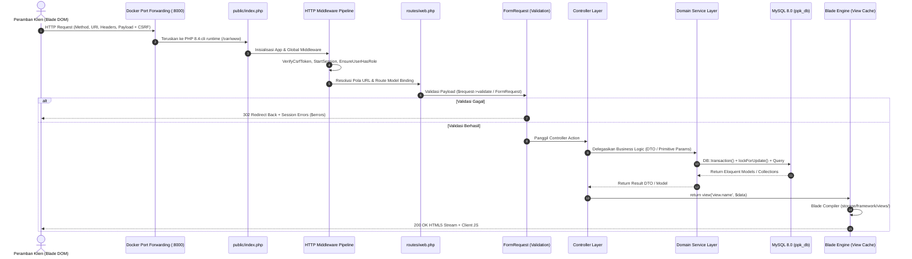

# DOKUMEN CODE DEFENSE & BEDAH ARSITEKTUR: RESVI
**Sistem Reservasi Fasilitas & Pelaporan Kendala Sarpras Kampus**  
*Workspace Path:* `/home/rafrusth/Attic/Programming/PPK/PPK-Room-Reservation`  
*Fokus:* Stage 1 (Global Master Map 17 User Stories) & Stage 2 (Modul 4: Triage & Verifikasi Petugas - US-08, US-09, US-10)

---

# STAGE 1: ARSITEKTUR GLOBAL & MATRIX KELACAKAN 17 USER STORIES

## 1. Topologi Kontainer & Batasan Eksekusi (*Docker Container Boundaries*)

Aplikasi **Resvi** berjalan secara terisolasi penuh di atas Docker Compose menggunakan 3 kontainer utama yang terhubung dalam satu *bridge network* privat (`ppk_network`):

```
[Host Browser] 
      │
      ├── :8000 ──> [ppk_app] (PHP 8.4-cli + Laravel 13 + Composer)
      │                     ├── Volume: .:/var/www
      │                     ├── Symlink Engine: storage/app/public <──> public/storage
      │                     └── Bridge Network: ppk_network
      │                               │
      ├── :3306 ──> [ppk_db] (MySQL 8.0) ── Volume: mysql_data
      │                               │
      └── :8080 ──> [ppk_phpmyadmin] ─┘
```

> [!IMPORTANT]
> **Aturan Eksekusi Perintah (Zero Host Execution Rule):**  
> Seluruh perintah framework tidak dijalankan langsung di mesin host, melainkan selalu didelegasikan ke dalam kontainer aplikasi:
> ```bash
> docker compose exec app php artisan <command>
> docker compose exec app composer <command>
> ```

---

## 2. Siklus Hidup Permintaan End-to-End (*Global HTTP Request Lifecycle*)



### Rantai Eksekusi:
1. **Entry Point & Container Bridge:** Permintaan HTTP masuk ke port 8000 host, diforward oleh Docker ke kontainer `ppk_app` dan diterima oleh `public/index.php`.
2. **Middleware Pipeline:** Dijalankan berurutan: `EncryptCookies` $\rightarrow$ `StartSession` $\rightarrow$ `ValidateCsrfToken` (mencegah CSRF melalui token `@csrf`) $\rightarrow$ `EnsureUserHasRole` (`role:admin`, `role:petugas`, atau `role:pengguna`).
3. **Routing & Binding:** `routes/web.php` mengevaluasi pola URL dan melakukan *Implicit Route Model Binding* ke model target (`{facility}`, `{reservation}`, `{report}`).
4. **Validation Layer:** FormRequest (`app/Http/Requests/...`) mengeksekusi `authorize()` dan `rules()`. Jika validasi gagal, Laravel melempar `ValidationException` (302 Redirect dengan `$errors` di session).
5. **Controller & Service Layer:** Controller bertindak sebagai orkestrator tipis (*thin controller*), mendelegasikan transaksi dan operasi konkurensi ke Domain Service (`app/Services/...`) yang dibungkus `DB::transaction()`.
6. **Blade View Compilation:** Blade memeriksa template di `resources/views`. Bila ada perubahan, template dikompilasi menjadi PHP murni di `storage/framework/views/` dan memancarkan respon HTML5 ke klien.

---

## 3. Master Traceability Matrix: 17 User Stories (US-01 s/d US-17)

| ID | Aktor | Deskripsi Fitur | Primary Blade View | HTTP Route & Verb | Controller & Method | FormRequest / Validation | Domain Service Layer | Model, Tabel & Storage |
| :--- | :--- | :--- | :--- | :--- | :--- | :--- | :--- | :--- |
| **US-01** | Pengunjung & Pengguna | Cek ketersediaan slot waktu fasilitas tanpa membuka privasi pemohon | `resources/views/facilities/show.blade.php` | `POST /reservations/check-availability` | `ReservationFlowController::checkAvailability` | `CheckAvailabilityRequest` | `FacilityAvailabilityService` | `Facility`, `Reservation` (`reservations`) |
| **US-02** | Pengunjung & Pengguna | Pencarian & filter fasilitas (tipe, lokasi, kapasitas) | `resources/views/facilities/index.blade.php` | `GET /facilities` | `FacilityController::index` | `FacilityFilterRequest` | `FacilityCatalogService` | `Facility`, `FacilityPhoto` (`facilities`) |
| **US-03** | Pengguna | Pengajuan reservasi slot waktu & agenda penggunaan | `resources/views/reservations/create.blade.php` | `POST /my/reservations` | `User\ReservationController::store` | `StoreReservationRequest` | `UserReservationService::createReservation` | `Reservation` (`reservations`) |
| **US-04** | Pengguna | Pembatalan mandiri sebelum cutoff time | `resources/views/user/reservations/show.blade.php` | `POST /my/reservations/{reservation}/cancel` | `User\ReservationController::cancel` | `CancelReservationRequest` | `UserReservationService::cancelReservation` | `Reservation` (`reservations`) |
| **US-05** | Pengguna | Riwayat & rincian status reservasi personal | `resources/views/user/reservations/index.blade.php` | `GET /my/reservations` | `User\ReservationController::index` | Validasi autentikasi & kepemilikan data | `UserReservationService` | `Reservation` relasi `facility` |
| **US-06** | Pengguna | Pelaporan kendala sarpras & upload bukti foto | `resources/views/user/reports/create.blade.php` | `POST /my/reports` | `User\ReportController::store` | `StoreReportRequest` | `UserReportService::createReport` | `Report` (`reports`), Disk: `public/reports` |
| **US-07** | Pengguna | Tracking progres & penyelesaian laporan kendala | `resources/views/user/reports/index.blade.php` | `GET /my/reports` | `User\ReportController::index` | Validasi autentikasi kepemilikan | `UserReportService` | `Report` (`reports`) |
| **US-08** | Petugas | Dashboard antrean reservasi & kendala aktif | `resources/views/staff/reservations/index.blade.php` | `GET /staff/reservations` | `Staff\ReservationController::index` | Query filter (`search`, `type`, `status`) | `StaffReservationService::getActiveQueue` | `Reservation`, `Report` |
| **US-09** | Petugas | Approval reservasi & auto-reject konflik jadwal | `resources/views/staff/reservations/show.blade.php` | `POST /staff/reservations/{reservation}/approve` | `Staff\ReservationController::approve` | Route Model Binding + Role Petugas | `StaffReservationService::approve` | `Reservation`, Lock For Update |
| **US-10** | Petugas | Pembatalan darurat reservasi disetujui (force majeure) | `resources/views/staff/reservations/partials/cancel-modal.blade.php` | `POST /staff/reservations/{reservation}/cancel` | `Staff\ReservationController::cancel` | `CancelUrgentReservationRequest` | `StaffReservationService::cancelUrgent` | `Reservation` (`reservations`) |
| **US-11** | Petugas | Disposisi laporan kendala (Proses $\rightarrow$ Selesai/Tolak) | `resources/views/staff/reports/show.blade.php` | `POST /staff/reports/{report}/resolve` | `Staff\ReportController::resolve` | `ResolveReportRequest` | `StaffReportService::resolve` | `Report` (`reports`) |
| **US-12** | Petugas | Tandai fasilitas dalam perbaikan & pulihkan status | `resources/views/staff/facilities/maintenance.blade.php` | `POST /staff/facilities/{facility}/update-status` | `Staff\FacilityController::updateStatus` | `UpdateOperationalStatusRequest` | `StaffFacilityService::updateStatus` | `Facility`, `FacilityStatusLog` |
| **US-13** | Administrator | Pendaftaran akun Petugas langsung secara administratif | `resources/views/admin/accounts/create.blade.php` | `POST /admin/accounts` | `Admin\AccountController::store` | `StoreAccountRequest` (`role:petugas`) | `AccountService::createAccount` | `User` (`users`) |
| **US-14** | Administrator | Pendaftaran akun Pengguna (Mahasiswa/Dosen/Tendik) | `resources/views/admin/accounts/create.blade.php` | `POST /admin/accounts` | `Admin\AccountController::store` | `StoreAccountRequest` (`role:pengguna`) | `AccountService::createAccount` | `User` (`users`) |
| **US-15** | Administrator | Audit akun & reset kredensial pengguna/petugas | `resources/views/admin/accounts/partials/password-modal.blade.php` | `POST /admin/accounts/{user}/reset-password` | `Admin\AccountController::resetPassword` | `ResetPasswordRequest` | `AccountService::resetPassword` | `User` (`users`) |
| **US-16** | Administrator | Master fasilitas: CRUD, deaktivasi & reaktivasi | `resources/views/admin/facilities/index.blade.php` | `PUT /admin/facilities/{facility}` | `Admin\FacilityController::update` | `UpdateFacilityRequest` | `FacilityService` | `Facility`, `FacilityPhoto`, Disk `public/facilities` |
| **US-17** | Administrator | Rekapitulasi okupansi & frekuensi kerusakan (Export CSV/PDF) | `resources/views/admin/recaps/index.blade.php` | `GET /admin/recaps/export` | `Admin\RecapController::export` | `RecapFilterRequest` | `RecapService::exportPdf`, `exportCsv` | Agregasi SQL `Reservation` & `Report` via DomPDF |

---

# STAGE 2: INTERACTIVE DEEP-DIVE & CODE DEFENSE ENGINE
## Modul 4: Triage & Verifikasi Petugas (US-08, US-09, US-10)

---

## BAGIAN 1: DEKONSTRUKSI LAPISAN BLADE VIEW (`resources/views/`)

### 1. Struktur Template & Direktif Blade Utama
Berkas acuan: `resources/views/staff/reservations/show.blade.php`

```blade
@extends('layouts.staff')

@section('title', 'Proses Reservasi #' . $reservation['reservation_number'] . ' · Petugas')

@section('content')
@php
    $statusVal = $reservation['status'] instanceof \BackedEnum ? $reservation['status']->value : (string) $reservation['status'];
    $resDate = $reservation['date'] instanceof \DateTimeInterface ? $reservation['date']->format('Y-m-d') : $reservation['date'];
@endphp
```

- `@extends('layouts.staff')`: Menginstruksikan Blade Compiler untuk menyuntikkan template ini ke dalam wrapper layout petugas yang memuat navigasi, stylesheet, dan header tema.
- `@php ... @endphp`: Normalisasi tipe data DTO / Model Array. Di PHP 8.4, status reservasi adalah PHP Backed Enum (`ReservationStatus`). Ekstraksi dilakukan ke tipe primitif string (`$statusVal`) untuk mengoptimalkan evaluasi logika perbandingan berikutnya di dalam template.
- `@if($statusVal === 'menunggu') ... @elseif($statusVal === 'disetujui')`: Percabangan tampilan berbasis status aktif. Jika status masih `menunggu`, panel menampilkan tombol Setujui dan Tolak. Jika sudah `disetujui`, panel menampilkan tombol Pembatalan Mendesak.
- `@include('staff.reservations.partials.reject-modal')` & `@include('staff.reservations.partials.cancel-modal')`: Menggabungkan sub-view modal ke dalam DOM induk sehingga modal dirender secara tersembunyi sejak awal dan dapat dibuka tanpa request tambahan.

### 2. Form Submission & Proteksi CSRF (US-09)
Pada `resources/views/staff/reservations/show.blade.php` baris 153–162:
```blade
<form method="POST" action="{{ route('staff.reservations.approve', ['reservation' => $reservation['id']]) }}">
    @csrf
    <button 
        type="submit" 
        class="bg-white hover:bg-[#e6e6e6] text-black font-medium text-xs px-5 py-2 rounded-full transition flex items-center gap-1.5 active:scale-95 shadow-none cursor-pointer">
        <svg class="w-3.5 h-3.5" fill="none" stroke="currentColor" viewBox="0 0 24 24"><path stroke-linecap="round" stroke-linejoin="round" stroke-width="2" d="M5 13l4 4L19 7"></path></svg>
        Setujui Reservasi
    </button>
</form>
```
- `@csrf`: Merender input tersembunyi `<input type="hidden" name="_token" value="...">`. Token divalidasi oleh middleware Laravel terhadap token pada sesi pengguna untuk mencegah eksploitasi Cross-Site Request Forgery.
- Penggunaan metode HTTP `POST`: Karena persetujuan mengubah state data permanen (pelanggaran idempotensi jika menggunakan GET), standar HTTP mensyaratkan metode `POST`.

### 3. Logika Client-Side JavaScript
Pada `resources/views/staff/reservations/partials/reject-modal.blade.php` baris 61–68:
```javascript
function openRejectModal() {
    document.getElementById('rejectModal').classList.remove('hidden');
}
function closeRejectModal() {
    document.getElementById('rejectModal').classList.add('hidden');
}
```
Modal memanfaatkan class utilitas Tailwind `fixed inset-0 z-50 bg-black/70 backdrop-blur-sm hidden`. JavaScript murni mengontrol visibilitas dialog melalui manipulasi class `hidden`.

Pada `resources/views/staff/reservations/index.blade.php` baris 218–230:
```javascript
function filterTable() {
    const query = searchQueue.value.toLowerCase().trim();
    const type = filterType.value.toLowerCase();
    const status = filterStatus.value.toLowerCase();

    rows.forEach(row => {
        const matchesSearch = !query || row.dataset.search.includes(query);
        const matchesType = !type || row.dataset.type === type;
        const matchesStatus = !status || row.dataset.status === status;

        row.style.display = (matchesSearch && matchesType && matchesStatus) ? '' : 'none';
    });
}
```
Penyaringan antrean dieksekusi secara instan di peramban klien menggunakan dataset HTML5 (`data-search`, `data-type`, `data-status`), menghindari beban latensi jaringan server.

---

## BAGIAN 2: BEDAH MIKRO KODE BACKEND BARIS PER BARIS

Berkas acuan: `app/Services/StaffReservationService.php` (Metode `approve`, baris 104–188)

```php
104: public function approve(Reservation $reservation, string $staffId): Reservation
105: {
106:     $approvedReservation = DB::transaction(function () use ($reservation, $staffId): ?Reservation {
107:         $lockedReservation = Reservation::query()
108:             ->where('id', $reservation->id)
109:             ->lockForUpdate()
110:             ->firstOrFail();
111: 
112:         if ($lockedReservation->status !== ReservationStatus::Menunggu) {
113:             throw ValidationException::withMessages([
114:                 'approve' => 'Hanya permohonan dengan status Menunggu yang dapat disetujui.',
115:             ]);
116:         }
117: 
118:         if (! $lockedReservation->start_date_time->isFuture()) {
119:             $lockedReservation->update([
120:                 'status' => ReservationStatus::Kedaluwarsa,
121:                 'expiration_reason' => 'Waktu mulai reservasi telah terlampaui sebelum disetujui petugas.',
122:             ]);
123: 
124:             return null;
125:         }
126: 
127:         $lockedFacility = Facility::query()
128:             ->where('id', $lockedReservation->facility_id)
129:             ->lockForUpdate()
130:             ->firstOrFail();
131: 
132:         if (! $lockedFacility->is_active) {
133:             throw ValidationException::withMessages([
134:                 'approve' => 'Fasilitas tidak aktif pada master data sehingga tidak dapat disetujui.',
135:             ]);
136:         }
137: 
138:         if ($lockedFacility->operational_status !== OperationalStatus::DapatDigunakan) {
139:             throw ValidationException::withMessages([
140:                 'approve' => 'Fasilitas sedang dalam perbaikan sehingga tidak dapat disetujui.',
141:             ]);
142:         }
143: 
144:         // Conflict check with other approved or ongoing reservations
145:         $hasConflict = Reservation::query()
146:             ->where('id', '!=', $lockedReservation->id)
147:             ->where('facility_id', $lockedReservation->facility_id)
148:             ->where('date', $lockedReservation->date)
149:             ->whereIn('status', [ReservationStatus::Disetujui, ReservationStatus::Berlangsung])
150:             ->where('start_time', '<', $lockedReservation->end_time)
151:             ->where('end_time', '>', $lockedReservation->start_time)
152:             ->exists();
153: 
154:         if ($hasConflict) {
155:             throw ValidationException::withMessages([
156:                 'approve' => 'Jadwal bentrok dengan reservasi lain yang telah disetujui pada fasilitas ini.',
157:             ]);
158:         }
159: 
160:         // Approve this reservation
161:         $lockedReservation->update([
162:             'status' => ReservationStatus::Disetujui,
163:             'approved_by_id' => $staffId,
164:             'approved_at' => now(),
165:         ]);
166: 
167:         // Auto-reject any other pending reservations conflicting with this slot
168:         $conflictingPending = Reservation::query()
169:             ->where('id', '!=', $lockedReservation->id)
170:             ->where('facility_id', $lockedReservation->facility_id)
171:             ->where('date', $lockedReservation->date)
172:             ->where('status', ReservationStatus::Menunggu)
173:             ->where('start_time', '<', $lockedReservation->end_time)
174:             ->where('end_time', '>', $lockedReservation->start_time)
175:             ->get();
176: 
177:         $now = now();
178:         foreach ($conflictingPending as $pending) {
179:             $pending->update([
180:                 'status' => ReservationStatus::Ditolak,
181:                 'rejection_reason' => 'Jadwal fasilitas telah diberikan kepada pengajuan lain (' . $lockedReservation->reservation_number . ').',
182:                 'rejected_by_id' => $staffId,
183:                 'rejected_at' => $now,
184:             ]);
185:         }
186: 
187:         return $lockedReservation->fresh(['facility', 'user', 'approvedBy']);
188:     });
```

### Rincian Analisis Sintaks & Mekanisme Runtime
- **Baris 106 (`DB::transaction(...)`):**
  - *Sintaks:* Database Transaction Closure.
  - *Justifikasi:* Menjaga prinsip ACID (*Atomicity, Consistency, Isolation, Durability*). Seluruh operasi (approval, pengecekan bentrok, dan auto-reject) harus selesai sukses secara utuh. Jika terjadi galat di tengah jalan, database MySQL otomatis membatalkan perubahan melalui `ROLLBACK`.
- **Baris 107–110 (`->lockForUpdate()->firstOrFail()`):**
  - *Sintaks:* Pessimistic Concurrency Control (`SELECT ... FOR UPDATE`).
  - *Justifikasi:* Mencegah *Race Condition*. Jika dua petugas menyetujui reservasi yang bertabrakan di detik yang sama, transaksi kedua ditahan oleh kunci baris eksklusif (*Exclusive Row Lock*) pada mesin InnoDB hingga transaksi pertama selesai melepaskan kunci.
- **Baris 112–116 (`$lockedReservation->status !== ReservationStatus::Menunggu`):**
  - *Sintaks:* State Transition Guard.
  - *Justifikasi:* Memastikan idempotensi. Jika reservasi telah ditolak atau dibatalkan tepat sebelum lock diperoleh, sistem menggagalkan proses dengan `ValidationException`.
- **Baris 118–125 (`! $lockedReservation->start_date_time->isFuture()`):**
  - *Sintaks:* Temporal Boundary Validation via Carbon.
  - *Justifikasi:* Mencegah persetujuan reservasi yang jadwal mulainya telah terlewati (*Backdated Approval*). Sistem secara otomatis mengalihkan status menjadi `Kedaluwarsa`.
- **Baris 127–130 (`Facility::query()->...->lockForUpdate()`):**
  - *Sintaks:* Secondary Aggregate Resource Lock.
  - *Justifikasi:* Mengunci fasilitas induk agar status operasionalnya tidak dapat diubah (misal menjadi 'Dalam Perbaikan') saat transaksi persetujuan sedang diverifikasi.
- **Baris 145–152 (Formula Deteksi Bentrok / Interval Intersection):**
  - *Sintaks:*
    ```php
    ->where('start_time', '<', $lockedReservation->end_time)
    ->where('end_time', '>', $lockedReservation->start_time)
    ```
  - *Justifikasi:* Teorema matematis perpotongan dua interval $[S_1, E_1)$ dan $[S_2, E_2)$. Bentrokan terjadi jika dan hanya jika $S_1 < E_2 \land E_1 > S_2$. Formula ini menjamin seluruh kasus tumpang tindih terdeteksi tanpa risiko false positive pada batas menit yang bersentuhan.
- **Baris 168–185 (Cascading Auto-Reject):**
  - *Sintaks:* Bulk Cascade State Transition.
  - *Justifikasi:* Sesuai aturan bisnis SRS BR-PTG-03. Seluruh permohonan lain yang berstatus `Menunggu` pada fasilitas dan rentang waktu yang sama otomatis ditolak disertai pencatatan audit nomor reservasi pemenang.

---

## BAGIAN 3: SIMULASI UJIAN SIDANG KODE (ORAL DEFENSE SIMULATOR)

### Simulasi 1: Penanganan Concurrency & Race Condition
> **Tanya (Dosen Penguji / Tech Lead):**  
> *"Bayangkan ada 2 petugas login di 2 komputer berbeda. Ada 2 reservasi yang jamnya bertabrakan (misal Ruang Aula jam 09:00 - 12:00). Kedua petugas mengklik tombol 'Setujui' tepat di milidetik yang sama. Mengapa sistem Anda dijamin 100% tidak akan menghasilkan Double-Booking? Tunjukkan bukti di kodenya!"*

> **Jawab (Rekomendasi Jawaban Anda):**  
> *"Sistem kami menjamin integritas data melalui kombinasi dua mekanisme di `StaffReservationService.php`: **ACID Database Transaction (`DB::transaction`)** dan **Pessimistic Concurrency Locking (`lockForUpdate()`)** pada level database InnoDB MySQL.
> 
> Saat Petugas A dan Petugas B menekan submit bersamaan:
> 1. Request dari Petugas A dan B masuk ke thread PHP masing-masing. Ketika thread Petugas A memanggil `Reservation::where('id', ...)->lockForUpdate()`, mesin InnoDB MySQL memasang *Exclusive Row Lock* dan mengunci baris fasilitas induk `Facility::lockForUpdate()`.
> 2. Thread Petugas B yang mencoba mengeksekusi operasi pada fasilitas yang sama akan diblokir (*blocked / wait queue*) oleh database hingga transaksi Petugas A tuntas (`COMMIT` atau `ROLLBACK`).
> 3. Transaksi Petugas A mengevaluasi formula bentrok di baris 150-151 (`start_time < end_time AND end_time > start_time`). Karena belum ada yang berstatus `disetujui`, Petugas A lolos dan status reservasi diubah menjadi `Disetujui`. Sekaligus di baris 178, reservasi milik Petugas B otomatis di-update menjadi `Ditolak`.
> 4. Begitu Petugas A selesai (`COMMIT`), giliran transaksi Petugas B berjalan. Namun saat membaca baris reservasi miliknya, statusnya sudah bukan `Menunggu` lagi (melainkan sudah `Ditolak` oleh Petugas A), sehingga guard condition di baris 112 melempar `ValidationException` dan menggagalkan persetujuan Petugas B secara aman tanpa double booking."*

> **Poin Kunci Wajib Sebut:** `Pessimistic Locking (lockForUpdate())`, `Exclusive Row Lock (InnoDB)`, `ACID Transaction Boundary`, `Mutual Exclusion`, `State Guard Validation`.

---

### Simulasi 2: Teorema Deteksi Bentrok Jadwal
> **Tanya (Dosen Penguji / Tech Lead):**  
> *"Mengapa Anda mendeteksi bentrok jadwal hanya dengan 2 klausa `where('start_time', '<', $lockedReservation->end_time)->where('end_time', '>', $lockedReservation->start_time)`? Mengapa tidak menggunakan 4 kondisi seperti pengecekan `BETWEEN`, overlap depan, overlap belakang, dan overlap dalam? Apakah tidak ada kasus bentrok yang lolos?"*

> **Jawab (Rekomendasi Jawaban Anda):**  
> *"Secara matematis, dua interval $[S_1, E_1)$ dan $[S_2, E_2)$ tidak bertabrakan jika dan hanya jika interval 1 berada seluruhnya di sebelah kiri interval 2 ($E_1 \le S_2$) ATAU interval 1 berada seluruhnya di sebelah kanan interval 2 ($S_1 \ge E_2$).
> 
> Berdasarkan hukum De Morgan, negasi dari kondisi 'tidak bentrok' adalah kondisi 'bentrok':
> $$\neg ((E_1 \le S_2) \lor (S_1 \ge E_2)) \iff (E_1 > S_2) \land (S_1 < E_2)$$
> Formula inilah yang diimplementasikan di baris 150-151: `start_time < new_end` dan `end_time > new_start`. 
> 
> Penggunaan operator `BETWEEN` dalam SQL justru merupakan anti-pattern berbahaya karena operator `BETWEEN` bersifat inklusif ($\le \text{dan} \ge$). Ini akan menyebabkan 'false positive' pada reservasi yang bersambungan persis di titik batas, misalnya Reservasi A selesai jam 10:00 dan Reservasi B mulai jam 10:00. Formula kami memperbolehkan pergantian slot tepat di batas waktu tanpa false conflict dan mencakup semua skenario overlap (enclosing, inside, left-overlap, right-overlap) dalam satu query indeks yang sangat efisien."*

> **Poin Kunci Wajib Sebut:** `Interval Intersection Theorem`, `De Morgan's Laws`, `Half-Open Interval Boundary [Start, End)`, `False Positive Prevention`, `Index-friendly Query`.

---

### Simulasi 3: Keabsahan Pembatalan Mendesak vs Audit Trail
> **Tanya (Dosen Penguji / Tech Lead):**  
> *"Pada fitur Pembatalan Mendesak Petugas (US-10), mengapa Anda tidak menggunakan `DELETE` untuk membersihkan data reservasi dari tabel `reservations`? Dan mengapa pembatalan dilarang jika waktu mulai reservasi telah tercapai?"*

> **Jawab (Rekomendasi Jawaban Anda):**  
> *"Kami menerapkan prinsip **Immutable Audit Trail** dan pemisahan status (*State Machine Transition*).
> 
> 1. **Alasan Tidak Menggunakan Hard Delete:** Dalam sistem sarpras kampus, setiap pengajuan adalah dokumen digital berharga. Jika dilakukan hard delete, institusi kehilangan jejak audit: kita tidak bisa mengetahui siapa petugas yang membatalkan, jam berapa dibatalkan, dan apa alasan mendesaknya (misal: pipa bocor atau korsleting listrik). Di method `cancelUrgent` baris 268-272, data dipertahankan dengan mengubah status menjadi `dibatalkan_oleh_petugas` serta menyimpan `cancellation_reason`, `cancelled_by_id`, dan `cancelled_at`. Data ini nantinya diagregasi di modul rekapitulasi (US-17).
> 2. **Alasan Pembatasan Waktu (`start_date_time->isFuture()`):** Jika waktu mulai kegiatan telah tiba, reservasi tersebut sudah masuk ranah operasional fisik (ruangan sedang digunakan atau sudah selesai). Pembatalan sepihak setelah kegiatan berlangsung melanggar integritas bisnis; kendala yang terjadi saat kegiatan berlangsung harus dilaporkan melalui modul pelaporan kendala (US-06), bukan pembatalan reservasi retrospektif."*

> **Poin Kunci Wajib Sebut:** `Immutable Audit Trail`, `State Machine Transition`, `Soft Cancellation over Hard Delete`, `Temporal Business Rule (start_date_time->isFuture())`.

