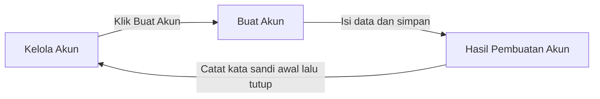
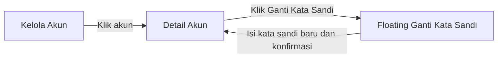
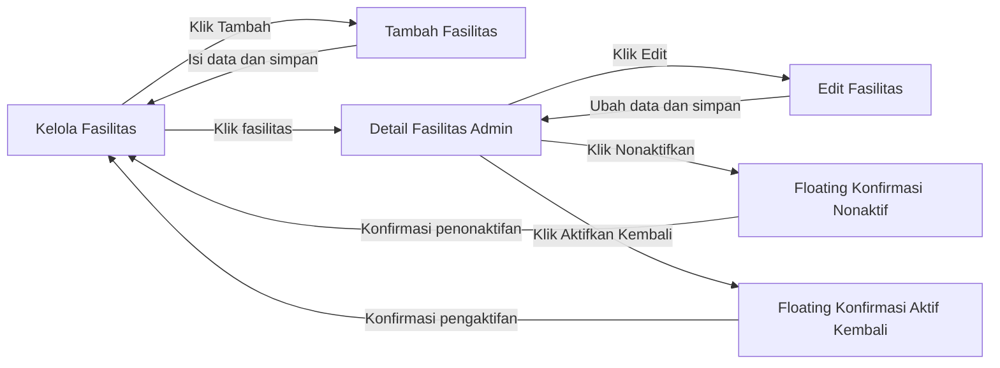
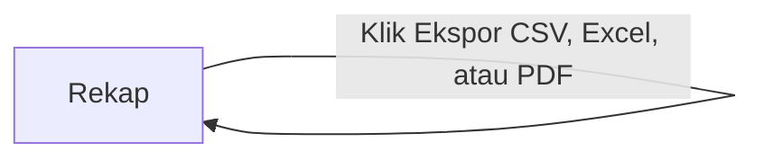

# SRS Admin — PPK Room Reservation

**Status dokumen:** Draf untuk ditinjau

**Aktor:** Admin yang telah login

## 1. Tujuan dan cakupan

Dokumen ini menjabarkan kebutuhan Admin berdasarkan User Story 13, 14, 16, dan 17 pada `CASE.md` serta keputusan pada `KEPUTUSAN-GLOBAL.md`. User Story 15 bersyarat pada adanya registrasi mandiri; karena registrasi mandiri telah ditiadakan, verifikasi atau penolakan akun hasil registrasi tidak masuk cakupan.

Ruang, lapangan, laboratorium, dan alat yang menetap di ruangan ditampilkan sebagai **Fasilitas**. Satu fasilitas adalah satu objek yang dapat direservasi; tidak ada pengelolaan stok alat.

## 2. Batas kewenangan

Admin dapat:

- Membuat akun Pengguna (Mahasiswa, Dosen, atau Staf) dan Petugas secara langsung.
- Menetapkan kata sandi baru bagi Pengguna atau Petugas yang lupa kata sandi.
- Menambah, mengedit, menonaktifkan, dan mengaktifkan kembali data master fasilitas.
- Melihat serta mengekspor rekap okupansi dan frekuensi kerusakan menurut fasilitas atau lokasi.

Admin tidak mendapat kewenangan dari user story ini untuk memproses reservasi, menangani laporan, atau mengubah status operasional `Dapat digunakan`/`Dalam perbaikan`. Tindakan tersebut merupakan kewenangan Petugas. Admin juga tidak dapat melihat kata sandi lama, membuat alur registrasi mandiri, atau menonaktifkan akun Pengguna/Petugas. Penonaktifan akun tidak termasuk cakupan sistem yang disepakati.

## 3. Kebutuhan fungsional

### FR-ADM-01 — Login dan akses Admin

Admin masuk melalui halaman login dengan akun Admin awal yang disediakan lewat seeding. Setelah berhasil login, Admin diarahkan ke halaman **Kelola Fasilitas** sebagai halaman kerja awal. Hanya akun berperan Admin yang dapat mengakses halaman dan aksi Admin. Admin dapat logout dan sesi autentikasinya diakhiri.

Navigasi Admin menyediakan **Kelola Fasilitas**, **Kelola Akun**, dan **Rekap**. Tidak diperlukan halaman statistik terpisah.

### FR-ADM-02 — Melihat daftar akun

Halaman Kelola Akun menampilkan akun Pengguna dan Petugas yang telah dibuat, sekurangnya nama, email, peran, dan kategori Pengguna jika relevan. Admin dapat membuka data akun untuk memastikan sasaran sebelum menetapkan kata sandi baru. Kata sandi, termasuk bentuk hash-nya, tidak ditampilkan dalam daftar atau detail akun.

Tidak ada daftar permohonan registrasi atau aksi verifikasi akun.

### FR-ADM-03 — Membuat akun Pengguna atau Petugas

Admin dapat membuat akun dengan nama, email, dan pilihan peran Pengguna atau Petugas. Jika peran Pengguna dipilih, Admin memilih kategori Mahasiswa, Dosen, atau Staf. Sistem memvalidasi isian wajib dan keunikan email sebelum menyimpan akun.

Sistem menghasilkan kata sandi awal dan menampilkannya **sekali** kepada Admin setelah akun berhasil dibuat. Admin menyampaikan kata sandi tersebut kepada pemilik akun di luar sistem. Setelah tampilan itu ditutup, kata sandi awal tidak dapat dilihat kembali. Akun yang dibuat langsung dapat digunakan untuk login; tidak ada tahap verifikasi atau kewajiban mengganti kata sandi saat login pertama.

### FR-ADM-04 — Menetapkan kata sandi baru

Admin dapat membuka aksi penggantian kata sandi dari akun Pengguna atau Petugas yang tepat dan menetapkan kata sandi baru. Sistem meminta konfirmasi tindakan, menyimpan kata sandi baru secara aman, dan tidak pernah menampilkan kata sandi lama. Penggantian kata sandi tidak mengubah peran atau data akun lain.

### FR-ADM-05 — Melihat daftar dan detail master fasilitas

Halaman Kelola Fasilitas menampilkan seluruh data fasilitas, termasuk yang aktif dan nonaktif. Setiap entri sekurangnya menunjukkan nama, tipe, lokasi, kapasitas jika ada, status aktif/nonaktif data, dan status operasional. Admin dapat membuka detail untuk melihat deskripsi dan foto jika tersedia.

Status **aktif/nonaktif data master** berbeda dari status operasional **`Dapat digunakan`/`Dalam perbaikan`**. Fasilitas nonaktif tidak ditampilkan pada Homepage Pengunjung/Pengguna dan tidak dapat menjadi sasaran pengajuan reservasi baru. Admin tetap dapat melihat datanya di halaman pengelolaan.

### FR-ADM-06 — Menambah fasilitas

Admin dapat membuat satu fasilitas baru dengan nama, tipe, lokasi, dan deskripsi. Tipe dipilih dari `Kelas`, `Aula`, `Laboratorium`, `Alat`, atau `Lapangan`. Kapasitas dapat dikosongkan untuk objek yang tidak memiliki kapasitas pengguna, seperti alat. Foto bersifat opsional. Satu data fasilitas mewakili satu objek reservasi tertentu, bukan kumpulan stok. Sistem memvalidasi isian wajib sebelum menyimpan.

Fasilitas baru langsung berstatus data master **aktif** dan berstatus operasional **`Dapat digunakan`**, sehingga muncul dalam daftar publik dan dapat diajukan untuk reservasi sesuai hasil pengecekan jadwal.

### FR-ADM-07 — Mengedit fasilitas

Admin dapat mengubah data master fasilitas, termasuk nama, tipe, lokasi, kapasitas, deskripsi, dan foto. Pengeditan data master tidak mengubah status operasional dan tidak secara otomatis memproses reservasi atau laporan. Data yang sudah dipakai transaksi tetap harus dapat diidentifikasi pada riwayat transaksi.

### FR-ADM-08 — Menonaktifkan fasilitas

Admin dapat memilih fasilitas aktif dan mengonfirmasi penonaktifan. Sistem hanya mengizinkan tindakan ini jika fasilitas tersebut **tidak mempunyai reservasi `Disetujui` atau `Berlangsung`**. Jika masih ada salah satunya, sistem memblokir penonaktifan dan menjelaskan alasannya kepada Admin. Pemeriksaan dilakukan kembali di server saat konfirmasi, bukan hanya ketika tombol ditampilkan.

Jika penonaktifan berhasil, seluruh pengajuan yang masih `Menunggu` dan belum mencapai waktu mulai pada fasilitas tersebut otomatis menjadi `Ditolak` dengan alasan sistem bahwa fasilitas dinonaktifkan; pengajuan tersebut **bukan** `Kedaluwarsa`. Pengajuan yang telah mencapai waktu mulai mengikuti aturan `Kedaluwarsa`, bukan diubah menjadi `Ditolak` karena penonaktifan. Fasilitas tidak muncul pada daftar publik dan tidak menerima pengajuan baru. Data fasilitas, reservasi, dan laporan yang sudah tercatat tidak dihapus. Pemeriksaan waktu dan reservasi aktif, penonaktifan, serta penolakan pengajuan `Menunggu` harus diproses secara konsisten agar tidak menghasilkan status yang saling bertentangan.

### FR-ADM-09 — Mengaktifkan kembali fasilitas

Admin dapat mengaktifkan kembali data fasilitas nonaktif. Setelah aktif, fasilitas kembali muncul dalam daftar publik. Pengaktifan kembali tidak mengubah status operasionalnya: jika masih `Dalam perbaikan`, fasilitas tetap tidak dapat direservasi sampai Petugas mengubah statusnya menjadi `Dapat digunakan`.

### FR-ADM-10 — Melihat rekap

Admin dapat melihat rekap **okupansi fasilitas** dan **frekuensi kerusakan** yang dikelompokkan berdasarkan fasilitas atau lokasi. Rekap menggunakan periode **bulanan**; Admin memilih bulan dan tahun untuk memperbarui hasil. Bulan berjalan menjadi periode bawaan. Jika tidak ada reservasi `Selesai` atau kejadian perbaikan pada bulan terpilih, sistem menampilkan nilai nol yang sesuai; jika penyebut okupansi nol, persentasenya ditampilkan sebagai tidak dapat dihitung, bukan `0%`.

Okupansi dihitung dari durasi reservasi `Selesai`, sedangkan frekuensi kerusakan dihitung dari kejadian perubahan status operasional ke `Dalam perbaikan`. Definisi perhitungan terperinci ada pada BR-ADM-03.

### FR-ADM-11 — Mengekspor rekap

Admin dapat mengekspor rekap yang sedang dipilih dalam **CSV, Excel, atau PDF**. Hasil ekspor harus memakai periode, jenis rekap, dan pengelompokan yang sama dengan pilihan pada halaman rekap serta menyertakan keterangan tersebut agar angka dapat ditafsirkan. Kewenangan ekspor diperiksa di server.

## 4. Aturan bisnis

### BR-ADM-01 — Akun tanpa registrasi mandiri

- Akun Admin awal berasal dari seeding; Admin membuat akun Pengguna dan Petugas secara langsung.
- Tidak ada formulir registrasi mandiri maupun status menunggu verifikasi akun.
- Email akun harus unik agar identitas login tidak ambigu.
- Kata sandi awal ditampilkan satu kali kepada Admin. Sistem tidak menyediakan fitur untuk melihat kata sandi lama atau mengulang tampilan kata sandi awal.
- Jika kata sandi terlupa, Admin menetapkan kata sandi baru; tidak ada kewajiban menggantinya saat login pertama.
- Penonaktifan akun Pengguna/Petugas tidak termasuk kebutuhan yang telah disetujui.

### BR-ADM-02 — Pengelolaan master dan operasional fasilitas

- Admin mengelola data master, termasuk menonaktifkan dan mengaktifkan kembali data fasilitas.
- Petugas mengelola status operasional `Dapat digunakan`/`Dalam perbaikan`.
- Penonaktifan data master tidak sama dengan menandai fasilitas `Dalam perbaikan`.
- Fasilitas baru langsung aktif dan berstatus operasional `Dapat digunakan`.
- Pengaktifan kembali data master tidak otomatis mengubah status operasional fasilitas.
- Penonaktifan diblokir bila ada reservasi `Disetujui` atau `Berlangsung` untuk fasilitas tersebut.
- Setelah penonaktifan berhasil, pengajuan yang masih `Menunggu` dan belum mencapai waktu mulai menjadi `Ditolak` otomatis dengan alasan penonaktifan. Pengajuan yang sudah mencapai waktu mulai menjadi `Kedaluwarsa` sesuai aturan waktu.
- Fasilitas nonaktif tidak dapat diajukan untuk reservasi baru, termasuk jika permintaan dikirim langsung ke server.
- Penonaktifan tidak menghapus fasilitas atau riwayat transaksinya.
- Validasi reservasi aktif, perubahan status fasilitas, dan penolakan pengajuan `Menunggu` harus konsisten terhadap tindakan bersamaan.
- Tidak ada kuantitas stok: satu entri fasilitas adalah satu objek reservasi.

### BR-ADM-03 — Rekap dan ekspor

- Admin dapat melihat dua jenis rekap: okupansi dan frekuensi kerusakan.
- Keduanya dapat disajikan per fasilitas atau per lokasi.
- Periode rekap adalah satu bulan kalender yang dipilih menurut bulan dan tahun; bawaan awal adalah bulan berjalan.
- **Okupansi bulanan per fasilitas** = total durasi reservasi berstatus `Selesai` pada bulan tersebut ÷ total durasi slot jam operasional fasilitas selama data masternya aktif pada bulan tersebut × 100%. Jam operasional adalah 07.00–20.00, yaitu 13 jam atau 26 slot per hari. Slot ketika fasilitas aktif tetapi berstatus `Dalam perbaikan` tetap masuk penyebut; slot saat data master nonaktif tidak masuk penyebut.
- Jika satu fasilitas dibuat, dinonaktifkan, atau diaktifkan kembali di tengah bulan, penyebut hanya mencakup slot operasional selama data masternya aktif. Jika penyebut nol, persentase ditampilkan sebagai **tidak dapat dihitung**, bukan `0%`.
- **Okupansi per lokasi** menggunakan jumlah durasi reservasi `Selesai` seluruh fasilitas di lokasi tersebut dibagi jumlah slot jam operasional aktif seluruh fasilitas tersebut. Persentase lokasi bukan rata-rata sederhana persentase tiap fasilitas.
- **Frekuensi kerusakan bulanan** = jumlah kejadian perubahan status operasional `Dapat digunakan → Dalam perbaikan` pada bulan tersebut, termasuk perubahan tanpa laporan sumber. Satu perubahan dihitung satu kejadian; lamanya perbaikan dan jumlah laporan terkait tidak menambah hitungan. Rekap per lokasi menjumlahkan kejadian pada fasilitas di lokasi itu.
- Okupansi di sini mencerminkan jadwal reservasi yang telah `Selesai`, bukan bukti penggunaan fisik yang dicatat terpisah. Reservasi `Menunggu`, `Disetujui`, `Berlangsung`, `Ditolak`, `Kedaluwarsa`, dan yang dibatalkan tidak masuk pembilang.
- CSV, Excel, dan PDF adalah format ekspor yang wajib tersedia sesuai User Story 17.
- Tampilan dan ekspor untuk pilihan yang sama harus menghasilkan angka yang konsisten.
- Riwayat perubahan aktif/nonaktif data master dan perubahan status operasional perlu dipertahankan agar rekap bulan lalu tidak berubah hanya karena status fasilitas saat ini berubah.

### BR-ADM-04 — Validasi dan jejak perubahan

Form pembuatan akun, penggantian kata sandi, tambah/edit fasilitas, dan konfirmasi perubahan status data memberi validasi serta umpan balik pada sisi klien. Sistem tetap memvalidasi peran Admin, isian penting, status terbaru fasilitas, dan bentrokan dengan proses persetujuan reservasi di server. Perubahan akun, kata sandi, dan master fasilitas mencatat identitas Admin serta waktu tindakan. Penyimpanan kata sandi menggunakan bentuk yang tidak dapat dibaca kembali sebagai teks asli.

## 5. Data minimal yang dikelola

| Objek | Data minimal pada kebutuhan Admin | Catatan |
|---|---|---|
| Akun | Nama, email, peran, kategori Pengguna bila relevan | Kata sandi tidak dapat dilihat kembali |
| Fasilitas | Nama, tipe, lokasi, kapasitas, deskripsi, status aktif/nonaktif, status operasional | Kapasitas dan foto boleh kosong; status operasional dikelola Petugas |
| Rekap | Jenis rekap, bulan dan tahun, pengelompokan, hasil per kelompok | Okupansi memakai durasi; frekuensi kerusakan memakai kejadian status `Dalam perbaikan` |

## 6. Flow Admin

Node menunjukkan halaman atau floating window. Edge menunjukkan aksi Admin. Perubahan atau validasi otomatis oleh sistem dijelaskan pada FR/BR, bukan dijadikan halaman tambahan.

### 6.1 Membuat akun

Halaman hasil menampilkan kata sandi awal sekali saja, tidak disimpan sebagai informasi yang dapat dibuka ulang.

### 6.2 Mengganti kata sandi akun

### 6.3 Mengelola fasilitas

### 6.4 Melihat dan mengekspor rekap

Ekspor mengunduh berkas tanpa membuka halaman kerja baru.

## 7. Tabel akses, informasi, dan halaman

| Aktor | Informasi yang dapat dilihat | Aksi yang dapat dilakukan | Halaman yang dapat diakses | Penamaan `.blade.php` |
|---|---|---|---|---|
| Admin | Form autentikasi | Login | Login bersama | `auth/login.blade.php` |
| Admin | Daftar Pengguna dan Petugas, tanpa kata sandi | Membuka detail dan formulir pembuatan akun | Kelola Akun | `admin/accounts/index.blade.php` |
| Admin | Nama, email, peran, dan kategori akun sasaran | Membuka aksi ganti kata sandi | Detail Akun | `admin/accounts/show.blade.php` |
| Admin | Form data akun | Membuat akun Pengguna atau Petugas | Buat Akun | `admin/accounts/create.blade.php` |
| Admin | Kata sandi awal yang tampil satu kali | Mencatatnya lalu menutup tampilan | Hasil Pembuatan Akun | `admin/accounts/created.blade.php` |
| Admin | Form kata sandi baru; tanpa kata sandi lama | Menetapkan kata sandi baru | Detail Akun — **floating window Ganti Kata Sandi** | `admin/accounts/show.blade.php` dengan partial `admin/accounts/partials/password-modal.blade.php` |
| Admin | Seluruh fasilitas aktif/nonaktif serta status operasionalnya | Membuka detail dan formulir tambah | Kelola Fasilitas — halaman awal | `admin/facilities/index.blade.php` |
| Admin | Data master dan status fasilitas | Membuka edit, konfirmasi nonaktif, atau konfirmasi aktif kembali | Detail Fasilitas Admin | `admin/facilities/show.blade.php` |
| Admin | Form data master fasilitas | Menambah fasilitas | Tambah Fasilitas | `admin/facilities/create.blade.php` |
| Admin | Form data master yang telah terisi | Mengedit fasilitas | Edit Fasilitas | `admin/facilities/edit.blade.php` |
| Admin | Identitas fasilitas yang akan dinonaktifkan | Mengonfirmasi penonaktifan | Detail Fasilitas Admin — **floating window Konfirmasi Nonaktif** | `admin/facilities/show.blade.php` dengan partial `admin/facilities/partials/deactivate-modal.blade.php` |
| Admin | Identitas fasilitas yang akan diaktifkan kembali | Mengonfirmasi pengaktifan | Detail Fasilitas Admin — **floating window Konfirmasi Aktif Kembali** | `admin/facilities/show.blade.php` dengan partial `admin/facilities/partials/reactivate-modal.blade.php` |
| Admin | Rekap okupansi dan frekuensi kerusakan per fasilitas/lokasi | Memilih bulan dan tahun, melihat hasil, mengekspor CSV/Excel/PDF | Rekap | `admin/recaps/index.blade.php` |

Nama Blade adalah rancangan penamaan, bukan kewajiban membuat seluruh halaman terpisah. Berkas ekspor bukan halaman Blade. Partial floating window tetap berada pada halaman induknya.

## 8. Kesesuaian dengan user story

- User Story 13 dipenuhi oleh pembuatan akun Petugas secara langsung oleh Admin.
- User Story 14 dipenuhi oleh pembuatan akun Pengguna untuk Mahasiswa, Dosen, dan Staf.
- User Story 15 tidak diterapkan karena syaratnya, registrasi mandiri, tidak diimplementasikan dan hal ini telah dikonfirmasi oleh dosen.
- User Story 16 dipenuhi oleh tambah, edit, dan nonaktif data fasilitas. Pengaktifan kembali adalah keputusan tambahan tim. Perubahan status operasional tetap milik Petugas sesuai User Story 12.
- User Story 17 dipenuhi oleh tampilan rekap okupansi dan frekuensi kerusakan menurut fasilitas/lokasi serta ekspor CSV, Excel, dan PDF.
- Penggantian kata sandi oleh Admin berasal dari keputusan tambahan tim pada `KEPUTUSAN-GLOBAL.md` §3.12, bukan dari User Story 13–17.
