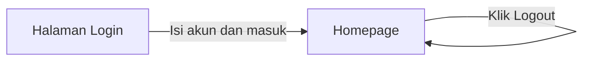
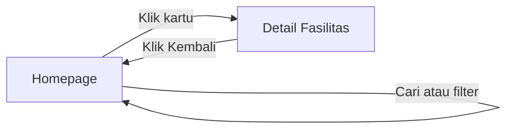
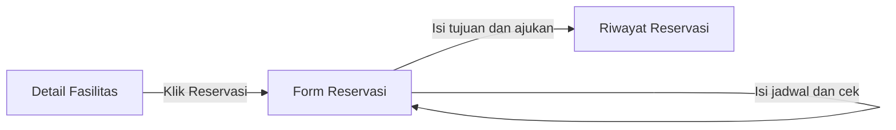
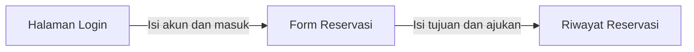
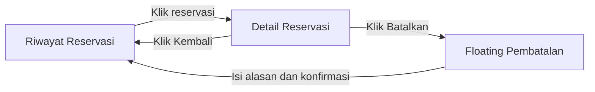
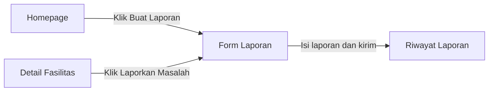
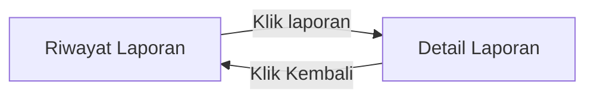

# SRS Pengguna — PPK Room Reservation

**Status dokumen:** Draf revisi berdasarkan keputusan global

**Aktor:** Pengguna (Mahasiswa, Dosen, atau Staf yang telah login)

## 1. Tujuan Dokumen

Dokumen ini mendefinisikan kebutuhan perangkat lunak, aturan bisnis, flow, dan rancangan halaman untuk aktor **Pengguna** pada sistem PPK Room Reservation.

Dokumen mengikuti `KEPUTUSAN-GLOBAL.md` dan melanjutkan alur publik dalam `SRS-PENGUNJUNG.md`. Homepage, Detail Fasilitas, dan Form Reservasi digunakan bersama oleh Pengunjung dan Pengguna.

Pada antarmuka, ruang, lapangan, laboratorium, dan alat yang menetap di ruangan disebut **Fasilitas**. Seluruhnya menggunakan logika reservasi yang sama tanpa konsep stok alat.

## 2. Definisi Aktor

Pengguna adalah Mahasiswa, Dosen, atau Staf yang mempunyai akun dan telah login. Penonaktifan akun tidak termasuk cakupan sistem yang disepakati.

Akun tidak dibuat melalui registrasi mandiri. Akun dibuat oleh Admin atau disediakan melalui seeding awal. Keputusan ini telah dikonfirmasi melalui konsultasi dengan dosen.

## 3. Ruang Lingkup Pengguna

Pengguna dapat:

- Login dan logout.
- Membuka Homepage yang langsung menampilkan daftar fasilitas.
- Mencari dan memfilter fasilitas.
- Melihat Detail Fasilitas.
- Memeriksa ketersediaan jadwal.
- Mengajukan reservasi dengan tujuan penggunaan.
- Melihat riwayat, status, dan detail reservasi miliknya.
- Membatalkan reservasi miliknya sesuai aturan.
- Membuat laporan kerusakan atau masalah pada satu fasilitas.
- Melihat riwayat, status, detail, dan catatan resolusi laporan miliknya.

Pengguna tidak dapat:

- Melakukan registrasi mandiri.
- Mengelola data master fasilitas.
- Menyetujui atau menolak pengajuan reservasi.
- Melihat reservasi atau laporan milik pengguna lain.
- Mengubah status fasilitas menjadi `Dalam perbaikan`.
- Mengubah status maupun catatan resolusi laporan.
- Mengakses fungsi Petugas atau Admin.

## 4. Konsep Fasilitas dan Status

### 4.1 Satu fasilitas per kartu

- Ruang, lapangan, laboratorium, dan alat ditampilkan dalam satu daftar.
- Satu kartu mewakili satu fasilitas tertentu.
- Alat tidak menggunakan stok, jumlah unit, alokasi unit, lokasi pengambilan, penyerahan, atau pengembalian.
- Kapasitas boleh kosong untuk fasilitas yang tidak mempunyai konsep kapasitas pengguna.

### 4.2 Status operasional

Status operasional fasilitas:

- `Dapat digunakan`
- `Dalam perbaikan`

Fasilitas `Dalam perbaikan` tidak dapat direservasi untuk tanggal apa pun. Aksi reservasi diblokir pada antarmuka dan server.

### 4.3 Hasil pemeriksaan jadwal

Hasil pemeriksaan jadwal:

- `Tersedia`
- `Tidak tersedia`

Status operasional `Dapat digunakan` tidak menjamin jadwal tertentu tersedia. Hasil `Tidak tersedia` dapat disebabkan bentrokan dengan reservasi lain.

## 5. Kebutuhan Fungsional

### 5.1 Autentikasi

#### FR-PGN-01 — Login

Pengguna dapat login menggunakan akun yang sudah tersedia.

Sistem harus:

- Memvalidasi kredensial.
- Menolak kredensial yang tidak valid.
- Tidak menyediakan tautan registrasi mandiri.
- Mengarahkan login biasa ke Homepage.
- Mengarahkan login dari proses reservasi kembali ke Form Reservasi dengan draft fasilitas dan jadwal tetap terisi.
- Hanya melanjutkan draft reservasi apabila akun yang login mempunyai peran Pengguna.
- Mengarahkan akun Petugas atau Admin ke halaman sesuai perannya tanpa melanjutkan draft reservasi.

#### FR-PGN-02 — Logout

Pengguna dapat logout dari sistem.

Setelah logout, sesi autentikasi diakhiri dan Pengguna diarahkan ke Homepage yang dapat diakses sebagai Pengunjung.

### 5.2 Informasi dan Reservasi Fasilitas

#### FR-PGN-03 — Melihat Homepage dan daftar fasilitas

Homepage langsung menampilkan daftar fasilitas dan tidak menggunakan landing page terpisah.

Satu kartu fasilitas minimal menampilkan:

- Nama fasilitas.
- Tipe fasilitas.
- Lokasi.
- Kapasitas, jika dimiliki.
- Status operasional.
- Foto utama, jika tersedia.

Fasilitas yang dinonaktifkan oleh Admin tidak ditampilkan.

#### FR-PGN-04 — Mencari dan memfilter fasilitas

Pengguna dapat mencari fasilitas berdasarkan nama.

Pengguna dapat memfilter fasilitas berdasarkan:

- Tipe.
- Lokasi.
- Kapasitas.

Ketentuan pencarian dan filter:

- Pencarian dan beberapa filter dapat digunakan bersamaan.
- Daftar diperbarui pada Homepage tanpa membuka halaman baru.
- Filter status operasional tidak disediakan.
- Fasilitas dengan kapasitas kosong tidak termasuk hasil ketika filter kapasitas digunakan.
- Pengguna dapat menghapus pencarian dan filter.

#### FR-PGN-05 — Melihat Detail Fasilitas

Pengguna dapat mengeklik kartu untuk membuka Detail Fasilitas.

Halaman detail minimal menampilkan:

- Nama fasilitas.
- Tipe fasilitas.
- Lokasi.
- Kapasitas, jika dimiliki.
- Deskripsi.
- Status operasional.
- Foto, jika tersedia.
- Informasi pendukung sesuai jenis fasilitas, jika tersedia.

Halaman detail menyediakan aksi:

- **Reservasi**, jika fasilitas `Dapat digunakan`.
- Aksi reservasi nonaktif disertai keterangan, jika fasilitas `Dalam perbaikan`.
- Kembali ke Homepage.

#### FR-PGN-06 — Memeriksa ketersediaan pada Form Reservasi

Pengguna membuka Form Reservasi dari Detail Fasilitas.

Form menampilkan:

- Fasilitas yang dipilih dan tidak dapat diganti dari dalam form.
- Tanggal penggunaan.
- Waktu mulai.
- Waktu selesai.
- Tombol **Cek Ketersediaan**.

Setelah hasil pengecekan menunjukkan `Tersedia`, form menampilkan atau mengaktifkan:

- Tujuan penggunaan.
- Tombol **Ajukan Reservasi**.

Sistem menampilkan hasil `Tersedia` atau `Tidak tersedia` setelah Pengguna menjalankan pengecekan.

Ketentuan form:

- Tombol **Ajukan Reservasi** tidak dapat digunakan sebelum jadwal yang sedang terisi memperoleh hasil `Tersedia`.
- Hasil `Tidak tersedia` membuat Pengguna tetap berada pada form untuk memilih jadwal lain.
- Perubahan tanggal, waktu mulai, atau waktu selesai membatalkan hasil pengecekan sebelumnya.
- Perubahan jadwal kembali menonaktifkan tombol **Ajukan Reservasi** sampai pengecekan berhasil dijalankan ulang.
- Tujuan penggunaan wajib diisi sebelum pengajuan dikirim.

Jika Pengguna berasal dari proses login Pengunjung, fasilitas dan jadwal diisi kembali dari draft sementara. Draft tidak mengunci jadwal.

#### FR-PGN-07 — Mengajukan reservasi

Pengguna dapat mengirim pengajuan apabila:

- Fasilitas masih aktif.
- Fasilitas berstatus `Dapat digunakan`.
- Jadwal telah diperiksa dan hasil terakhir `Tersedia`.
- Tujuan penggunaan telah diisi.
- Seluruh validasi waktu terpenuhi.
- Tidak terdapat pengajuan duplikat milik Pengguna yang masih `Menunggu` atau `Disetujui`.

Sistem harus memeriksa kembali status fasilitas, validitas waktu, dan bentrokan di sisi server ketika pengajuan dikirim.

Jika pemeriksaan terakhir gagal, pengajuan tidak dibuat dan Pengguna tetap berada pada Form Reservasi untuk memperbaiki data atau memilih jadwal lain.

Pengajuan yang berhasil dibuat memperoleh status awal `Menunggu`.

#### FR-PGN-08 — Melihat riwayat reservasi

Pengguna dapat melihat seluruh reservasi miliknya.

Daftar minimal menampilkan:

- Nomor reservasi.
- Fasilitas.
- Tanggal dan waktu penggunaan.
- Status.
- Waktu pengajuan.

#### FR-PGN-09 — Melihat detail reservasi

Pengguna dapat melihat detail reservasi miliknya yang berisi:

- Nomor reservasi.
- Fasilitas dan lokasi.
- Tanggal penggunaan.
- Waktu mulai dan selesai.
- Tujuan penggunaan.
- Status reservasi.
- Alasan penolakan, jika ditolak.
- Alasan pembatalan dan pihak yang membatalkan, jika dibatalkan.
- Alasan kedaluwarsa, jika kedaluwarsa.
- Waktu pengajuan dan perubahan terakhir.

#### FR-PGN-10 — Membatalkan reservasi

Pengguna dapat membatalkan reservasi miliknya apabila:

- Status reservasi `Menunggu` atau `Disetujui`.
- Waktu mulai belum tercapai.
- Alasan pembatalan diisi.

Tidak terdapat batas minimal waktu pembatalan sebelum waktu mulai.

Setelah pembatalan berhasil, status menjadi `Dibatalkan oleh pengguna`.

Reservasi `Berlangsung`, `Selesai`, `Ditolak`, `Dibatalkan oleh pengguna`, `Dibatalkan oleh petugas`, atau `Kedaluwarsa` tidak dapat dibatalkan oleh Pengguna.

#### FR-PGN-11 — Melihat status reservasi

Status reservasi yang dapat dilihat Pengguna:

- `Menunggu`
- `Disetujui`
- `Berlangsung`
- `Selesai`
- `Ditolak`
- `Dibatalkan oleh pengguna`
- `Dibatalkan oleh petugas`
- `Kedaluwarsa`

### 5.3 Laporan Kerusakan atau Masalah

#### FR-PGN-12 — Membuat laporan fasilitas

Pengguna dapat membuat laporan untuk satu fasilitas, termasuk ruang, lapangan, laboratorium, atau alat.

Form laporan memuat:

- Fasilitas yang dilaporkan.
- Kategori laporan.
- Deskripsi.
- Foto opsional.

Pengguna boleh melaporkan fasilitas meskipun tidak pernah mereservasinya.

Form Laporan dapat dibuka melalui:

- Aksi **Buat Laporan** pada Homepage; Pengguna memilih satu fasilitas pada form.
- Aksi **Laporkan Masalah** pada Detail Fasilitas; fasilitas otomatis terisi pada form.

Kedua jalur menggunakan Form Laporan yang sama.

Pembuatan laporan tidak otomatis mengubah status fasilitas menjadi `Dalam perbaikan`. Perubahan status dilakukan Petugas setelah melakukan pemeriksaan.

#### FR-PGN-13 — Melihat riwayat laporan

Pengguna dapat melihat seluruh laporan miliknya.

Daftar minimal menampilkan:

- Nomor laporan.
- Fasilitas yang dilaporkan.
- Kategori.
- Tanggal laporan.
- Status laporan.

Status laporan:

- `Baru`: laporan berhasil dikirim dan belum mulai ditangani.
- `Diproses`: Petugas sudah mulai menangani laporan.
- `Selesai`: penanganan selesai dan catatan resolusi tersedia.
- `Ditolak`: laporan tidak dapat ditindaklanjuti dan alasan penolakan tersedia.

#### FR-PGN-14 — Melihat detail laporan

Pengguna dapat melihat detail laporan miliknya yang berisi:

- Nomor laporan.
- Fasilitas yang dilaporkan.
- Kategori.
- Deskripsi.
- Foto, jika dilampirkan.
- Status.
- Catatan resolusi, jika tersedia.
- Alasan penolakan, jika ditolak.
- Waktu dibuat dan diperbarui.

## 6. Aturan Bisnis

### BR-PGN-01 — Aturan waktu

- Jam operasional adalah 07.00–20.00.
- Waktu mulai dan waktu selesai menggunakan kelipatan 30 menit.
- Waktu selesai harus lebih besar daripada waktu mulai.
- Waktu mulai dan selesai berada pada tanggal yang sama.
- Waktu mulai harus lebih besar daripada waktu saat pengajuan diproses di server; jadwal yang sudah mencapai waktu mulai tidak dapat diajukan.
- Tidak terdapat batas maksimal tanggal reservasi di masa depan.
- Validasi waktu dilakukan kembali di sisi server.

### BR-PGN-02 — Pemeriksaan bentrokan

Dua rentang waktu bertabrakan apabila:

```text
waktu_mulai_baru < waktu_selesai_lama
DAN
waktu_selesai_baru > waktu_mulai_lama
```

Rentang yang berakhir tepat ketika rentang lain dimulai tidak dianggap bertabrakan.

| Reservasi yang mengunci jadwal | Jadwal baru | Hasil |
|---|---|---|
| 09.00–10.00 | 08.30–09.00 | Tidak bentrok |
| 09.00–10.00 | 09.00–09.30 | Bentrok |
| 09.00–10.00 | 09.30–10.30 | Bentrok |
| 09.00–10.00 | 10.00–11.00 | Tidak bentrok |

Reservasi `Disetujui` atau `Berlangsung` mengunci jadwal. Pengajuan `Menunggu` tidak mengunci jadwal.

Satu Pengguna boleh mempunyai reservasi dengan waktu yang bertabrakan apabila fasilitasnya berbeda. Pemeriksaan bentrokan dilakukan terhadap fasilitas yang sama.

### BR-PGN-03 — Pemeriksaan dan pengiriman form

- Hasil pengecekan awal tidak mengunci jadwal.
- Draft dari Pengunjung tidak mengunci jadwal.
- Perubahan jadwal membatalkan hasil pengecekan sebelumnya.
- Server memeriksa ulang ketersediaan ketika pengajuan dikirim.
- Pengajuan hanya dibuat jika pemeriksaan terakhir berhasil.
- Sistem menolak pengajuan duplikat dari Pengguna yang sama untuk fasilitas, tanggal, waktu mulai, dan waktu selesai yang sama selama pengajuan sebelumnya masih `Menunggu` atau `Disetujui`.

### BR-PGN-04 — Persetujuan reservasi

Beberapa pengajuan `Menunggu` boleh memilih fasilitas dan jadwal yang sama.

Ketika Petugas menyetujui satu pengajuan, sistem harus:

1. Memulai transaksi database.
2. Memeriksa reservasi `Disetujui` atau `Berlangsung` yang bertabrakan.
3. Mengunci proses pemeriksaan dan persetujuan agar dua pengajuan tidak disetujui bersamaan.
4. Mengubah pengajuan terpilih menjadi `Disetujui` jika tidak terdapat bentrokan.
5. Mengubah pengajuan `Menunggu` lain yang bertabrakan menjadi `Ditolak`.
6. Menyimpan alasan bahwa jadwal telah diberikan kepada pengajuan lain.

Penolakan otomatis tetap menggunakan status `Ditolak`.

### BR-PGN-05 — Perubahan status berdasarkan waktu

```text
Menunggu -- tepat saat waktu mulai tercapai --> Kedaluwarsa
Disetujui -- waktu mulai tercapai --> Berlangsung
Berlangsung -- waktu selesai terlewati --> Selesai
```

Status `Kedaluwarsa` berarti pengajuan masih `Menunggu` tepat saat waktu mulai tercapai. Pengajuan tersebut tidak dapat disetujui atau ditolak manual setelah batas ini, sekalipun pembaruan status terjadwal belum dijalankan; server harus memakai waktu saat tindakan diproses.

Status `Berlangsung` dan `Selesai` dapat dihitung berdasarkan waktu tanpa tindakan manual Petugas.

### BR-PGN-06 — Pembatalan reservasi

- Pengguna dapat membatalkan `Menunggu` atau `Disetujui` sebelum waktu mulai.
- Tidak terdapat batas minimal waktu pembatalan sebelum waktu mulai.
- Alasan pembatalan wajib diisi.
- Setelah waktu mulai, reservasi tidak dapat dibatalkan Pengguna.
- Pembatalan Petugas terhadap reservasi `Disetujui` hanya dilakukan dalam keadaan mendesak dan wajib mempunyai alasan.
- Sistem menyimpan pelaku, peran pelaku, waktu, dan alasan pembatalan.

### BR-PGN-07 — Fasilitas dalam perbaikan

- Fasilitas `Dalam perbaikan` tidak dapat menerima pengajuan reservasi baru untuk tanggal apa pun.
- Aksi reservasi diblokir pada antarmuka.
- Server tetap menolak permintaan yang mencoba melewati antarmuka.
- Kode respons penolakan belum ditentukan pada tahap SRS.
- Ketika fasilitas berubah menjadi `Dalam perbaikan`, pengajuan yang masih `Menunggu` sebelum waktu mulai otomatis `Ditolak` dan reservasi `Disetujui` yang belum dimulai otomatis `Dibatalkan oleh petugas`, dengan alasan perubahan status fasilitas. Pengajuan yang telah mencapai waktu mulai menjadi `Kedaluwarsa`; reservasi `Berlangsung` tidak dibatalkan otomatis.

### BR-PGN-08 — Penonaktifan data fasilitas oleh Admin

- Admin tidak dapat menonaktifkan fasilitas yang mempunyai reservasi `Disetujui` atau `Berlangsung`.
- Jika penonaktifan berhasil, pengajuan yang masih `Menunggu` dan belum mencapai waktu mulai otomatis menjadi `Ditolak` dengan alasan fasilitas dinonaktifkan. Pengajuan yang telah mencapai waktu mulai mengikuti aturan `Kedaluwarsa`.
- Fasilitas nonaktif tidak muncul di Homepage dan tidak menerima pengajuan baru. Reservasi serta laporan lama tetap dapat dilihat dalam riwayat pemiliknya.
- Pengaktifan kembali fasilitas oleh Admin tidak membuka kembali pengajuan yang telah `Ditolak`.

### BR-PGN-09 — Laporan

- Satu laporan merujuk satu fasilitas.
- Foto bersifat opsional.
- Pengguna tidak harus mempunyai riwayat reservasi terhadap fasilitas yang dilaporkan.
- Laporan baru memperoleh status `Baru`.
- Status berubah menjadi `Diproses` ketika Petugas mulai menangani laporan.
- Status `Selesai` memerlukan catatan resolusi.
- Status `Ditolak` memerlukan alasan penolakan.
- Penolakan laporan hanya dapat dilakukan setelah status berubah dari `Baru` menjadi `Diproses`.
- Laporan tidak otomatis mengubah status operasional fasilitas.

### BR-PGN-10 — Akses dan privasi

- Pengguna hanya dapat melihat reservasi dan laporan miliknya sendiri.
- Pemeriksaan kepemilikan dilakukan di sisi server.
- Pengguna tidak dapat melihat identitas, tujuan penggunaan, atau detail reservasi pengguna lain.
- Pengguna tidak dapat memanggil fungsi persetujuan, penolakan, perubahan status operasional, atau resolusi laporan.

## 7. Validasi Form

### 7.1 Form Reservasi

Field wajib:

- Fasilitas.
- Tanggal.
- Waktu mulai.
- Waktu selesai.
- Tujuan penggunaan.

Prasyarat pengajuan:

- Jadwal yang sedang terisi telah diperiksa.
- Hasil pengecekan terakhir adalah `Tersedia`.
- Data master fasilitas masih aktif.
- Fasilitas masih berstatus `Dapat digunakan`.
- Server memeriksa ulang seluruh persyaratan ketika form dikirim.

### 7.2 Form pembatalan

Field wajib:

- Alasan pembatalan.

### 7.3 Form laporan

Field wajib:

- Fasilitas.
- Kategori.
- Deskripsi.

Field opsional:

- Foto.

Validasi form penting dilakukan pada sisi klien dan server. Validasi sisi klien tidak menggantikan validasi server.

## 8. Kebutuhan Data Minimum yang Ditampilkan

### 8.1 Reservasi

- Nomor reservasi.
- Fasilitas dan lokasi.
- Waktu mulai dan selesai.
- Tujuan penggunaan.
- Status.
- Alasan penolakan, pembatalan, atau kedaluwarsa.
- Pihak yang membatalkan, jika dibatalkan.
- Waktu dibuat dan diperbarui.

### 8.2 Laporan

- Nomor laporan.
- Fasilitas.
- Kategori.
- Deskripsi.
- Foto, jika tersedia.
- Status.
- Catatan resolusi atau alasan penolakan.
- Waktu dibuat dan diperbarui.

## 9. Di Luar Ruang Lingkup Pengguna

- Registrasi mandiri.
- Pengelolaan akun.
- Pengelolaan data master fasilitas.
- Persetujuan atau penolakan reservasi.
- Perubahan status fasilitas menjadi `Dalam perbaikan`.
- Perubahan status atau resolusi laporan.
- Reservasi lintas hari.
- Stok alat dan jumlah unit tersedia.
- Pemilihan atau alokasi unit alat.
- Lokasi pengambilan alat.
- Penyerahan dan pengembalian alat.
- Status `Dipinjam`, `Terlambat`, atau `Dikembalikan`.

## 10. Flow Pengguna

Flow dibagi berdasarkan kasus. Node menunjukkan halaman atau floating window, sedangkan edge menunjukkan tindakan Pengguna.

### 10.1 Login dan logout



Setelah logout, halaman yang sama tetap dapat diakses dengan hak Pengunjung.

### 10.2 Menemukan dan melihat fasilitas



### 10.3 Mengajukan reservasi



Form hanya dapat dikirim ketika hasil pengecekan jadwal yang sedang terisi adalah `Tersedia`. Server memeriksa ulang ketersediaan ketika form dikirim.

### 10.4 Melanjutkan draft setelah login



Fasilitas dan jadwal diisi dari draft sementara. Jadwal tetap diperiksa ulang ketika pengajuan dikirim.

### 10.5 Melihat dan membatalkan reservasi



Aksi **Batalkan** hanya tersedia untuk reservasi `Menunggu` atau `Disetujui` sebelum waktu mulai.

### 10.6 Membuat laporan



Satu laporan hanya merujuk satu fasilitas. Jika form dibuka dari Detail Fasilitas, fasilitas otomatis terisi. Foto dapat dilampirkan tetapi tidak wajib.

### 10.7 Melihat laporan



## 11. Tabel Akses, Informasi, dan Halaman

### 11.1 Autentikasi dan navigasi

| Aktor | Informasi yang dapat dilihat | Aksi yang dapat dilakukan | Halaman yang dapat diakses | Penamaan `.blade.php` |
|---|---|---|---|---|
| Pengguna | Form login dan pesan validasi | Mengisi kredensial dan masuk | Login | `auth/login.blade.php` |
| Pengguna | Daftar fasilitas dan navigasi fitur Pengguna | Mencari, memfilter, membuka riwayat, membuat laporan, atau logout | Homepage | `facilities/index.blade.php` |

### 11.2 Reservasi fasilitas

| Aktor | Informasi yang dapat dilihat | Aksi yang dapat dilakukan | Halaman yang dapat diakses | Penamaan `.blade.php` |
|---|---|---|---|---|
| Pengguna | Daftar fasilitas: nama, tipe, lokasi, kapasitas jika ada, status operasional, dan foto jika ada | Mencari berdasarkan nama serta memfilter berdasarkan tipe, lokasi, dan kapasitas | Homepage | `facilities/index.blade.php` |
| Pengguna | Nama, tipe, lokasi, kapasitas jika ada, deskripsi, status operasional, foto, dan informasi pendukung | Membuka Form Reservasi, membuka Form Laporan, atau kembali ke Homepage | Detail Fasilitas | `facilities/show.blade.php` |
| Pengguna | Fasilitas, jadwal, hasil pengecekan, dan tujuan penggunaan | Memeriksa jadwal, mengubah jadwal, dan mengajukan reservasi | Form Reservasi | `reservations/create.blade.php` |
| Pengguna | Daftar reservasi miliknya beserta waktu dan status | Membuka detail reservasi | Riwayat Reservasi | `user/reservations/index.blade.php` |
| Pengguna | Data lengkap reservasi dan alasan terkait status | Membuka pembatalan atau kembali ke riwayat | Detail Reservasi | `user/reservations/show.blade.php` |
| Pengguna | Form alasan pembatalan | Mengisi alasan dan mengonfirmasi pembatalan | Detail Reservasi — **floating window Pembatalan** | `user/reservations/show.blade.php`, dengan partial `user/reservations/partials/cancel-modal.blade.php` |

### 11.3 Laporan

| Aktor | Informasi yang dapat dilihat | Aksi yang dapat dilakukan | Halaman yang dapat diakses | Penamaan `.blade.php` |
|---|---|---|---|---|
| Pengguna | Form fasilitas, kategori, deskripsi, dan foto opsional | Memilih fasilitas jika belum terisi, kemudian mengisi dan mengirim laporan | Form Laporan | `user/reports/create.blade.php` |
| Pengguna | Daftar laporan miliknya: fasilitas, kategori, tanggal, dan status | Membuka detail laporan | Riwayat Laporan | `user/reports/index.blade.php` |
| Pengguna | Fasilitas, kategori, deskripsi, foto, status, catatan resolusi, dan alasan penolakan | Kembali ke riwayat | Detail Laporan | `user/reports/show.blade.php` |

## 12. Keputusan Rancangan Halaman dan Blade

- Homepage, Detail Fasilitas, dan Form Reservasi digunakan bersama oleh Pengunjung dan Pengguna.
- View bersama ditempatkan pada `facilities/` dan `reservations/`, bukan di bawah folder aktor.
- Riwayat, detail transaksi, pembatalan, dan laporan milik akun ditempatkan di bawah `user/` karena memerlukan login dan pemeriksaan kepemilikan.
- Form Reservasi merupakan halaman tersendiri dan menangani pengecekan jadwal serta pengajuan.
- Pembatalan menggunakan floating window karena hanya meminta alasan dan konfirmasi singkat.
- Fasilitas dan alat tidak mempunyai halaman maupun flow reservasi yang terpisah.
- Sistem tidak mempunyai view stok, penyerahan, atau pengembalian alat.

Rencana struktur:

```text
resources/views/
├── auth/
│   └── login.blade.php
├── facilities/
│   ├── index.blade.php
│   └── show.blade.php
├── reservations/
│   └── create.blade.php
└── user/
    ├── reports/
    │   ├── create.blade.php
    │   ├── index.blade.php
    │   └── show.blade.php
    └── reservations/
        ├── index.blade.php
        ├── show.blade.php
        └── partials/
            └── cancel-modal.blade.php
```

## 13. Kesesuaian dengan `CASE.md` dan Hasil Konsultasi

- Pengguna dapat melihat, mencari, memfilter, dan memeriksa ketersediaan fasilitas. Berbeda dari bunyi awal User Story 1, hasil per pilihan slot ditampilkan pada Form Reservasi, bukan bersama daftar; kartu daftar hanya menunjukkan status operasional.
- Pengguna dapat mengajukan reservasi pada rentang waktu tertentu dengan tujuan penggunaan.
- Pengguna dapat membatalkan reservasi sebelum waktu mulai dengan alasan wajib.
- Pengguna dapat melihat riwayat, status, dan detail reservasi miliknya.
- Pengguna dapat membuat dan melihat status laporan.
- Tidak ada registrasi mandiri berdasarkan konfirmasi dosen bahwa akun dibuat oleh Admin.
- Ruang, lapangan, laboratorium, dan alat menggunakan satu alur reservasi tanpa stok.
- Status awal laporan menggunakan `Baru` sesuai User Story 11.

## 14. Hal yang Belum Ditetapkan

- Daftar kategori laporan.

Struktur laporan tetap sama untuk seluruh tipe fasilitas; tidak ada field tambahan khusus tipe pada cakupan awal. Detail yang tidak tertampung dapat ditulis pada deskripsi.
