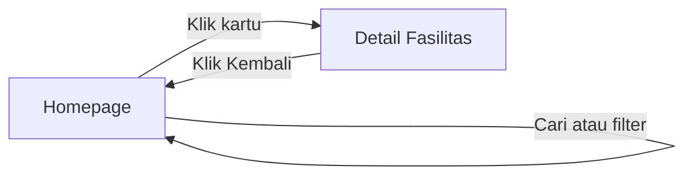
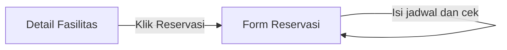
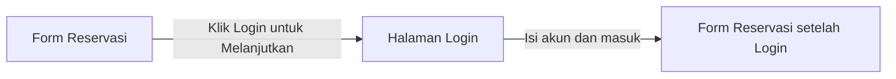

# SRS Pengunjung — PPK Room Reservation

**Status dokumen:** Draf revisi berdasarkan keputusan global

**Aktor:** Pengunjung (tidak login)

## 1. Tujuan Dokumen

Dokumen ini mendefinisikan kebutuhan perangkat lunak, aturan bisnis, flow, dan rancangan halaman untuk aktor **Pengunjung** pada sistem PPK Room Reservation.

Dokumen mengikuti keputusan dalam `KEPUTUSAN-GLOBAL.md`. Pada antarmuka, ruang, lapangan, laboratorium, dan alat yang menetap di ruangan disebut **Fasilitas** dan menggunakan logika reservasi yang sama.

## 2. Definisi Aktor

Pengunjung adalah orang yang mengakses sistem tanpa sesi login.

Pengunjung dapat melihat daftar dan detail fasilitas serta memeriksa ketersediaan jadwal. Pengunjung tidak dapat mengirim pengajuan reservasi sebelum berhasil login.

Sistem tidak menyediakan registrasi mandiri. Akun Pengguna dibuat oleh Admin atau tersedia melalui seeding awal. Keputusan ini telah dikonfirmasi melalui konsultasi dengan dosen.

## 3. Ruang Lingkup Pengunjung

Pengunjung dapat:

- Membuka Homepage yang langsung menampilkan daftar fasilitas.
- Melihat ruang, lapangan, laboratorium, dan alat dalam satu daftar.
- Mencari fasilitas berdasarkan nama.
- Memfilter fasilitas berdasarkan tipe, lokasi, dan kapasitas.
- Melihat status operasional fasilitas.
- Membuka halaman Detail Fasilitas.
- Membuka Form Reservasi untuk fasilitas yang dapat digunakan.
- Memilih jadwal dan memeriksa ketersediaan.
- Login untuk melanjutkan pengajuan ketika jadwal tersedia.

Pengunjung tidak dapat:

- Mengirim pengajuan reservasi sebelum login.
- Membatalkan reservasi.
- Membuat laporan kerusakan atau masalah.
- Melihat riwayat reservasi atau laporan.
- Melihat identitas pemesan lain.
- Melihat tujuan penggunaan reservasi lain.
- Melihat detail reservasi yang menyebabkan bentrokan.
- Mengakses fungsi Petugas atau Admin.
- Melakukan registrasi mandiri.

## 4. Konsep Status Fasilitas

Sistem menggunakan status operasional dan hasil pemeriksaan jadwal sebagai dua hal yang berbeda.

### 4.1 Status operasional

Status operasional disimpan pada data fasilitas dan ditampilkan pada kartu serta halaman detail:

- `Dapat digunakan`
- `Dalam perbaikan`

Status `Dapat digunakan` berarti fasilitas boleh dilanjutkan ke Form Reservasi. Status tersebut tidak menjamin jadwal tertentu tersedia.

Fasilitas berstatus `Dalam perbaikan` tidak dapat direservasi untuk tanggal apa pun. Antarmuka menonaktifkan aksi reservasi, sedangkan server tetap menolak permintaan yang mencoba melewati antarmuka.

Fasilitas yang dinonaktifkan oleh Admin tidak ditampilkan kepada Pengunjung.

### 4.2 Hasil pemeriksaan jadwal

Hasil pemeriksaan jadwal hanya menggunakan:

- `Tersedia`
- `Tidak tersedia`

Fasilitas berstatus `Dapat digunakan` tetap dapat memperoleh hasil `Tidak tersedia` apabila jadwal yang dipilih bertabrakan dengan reservasi lain.

## 5. Kebutuhan Fungsional

### FR-PG-01 — Melihat Homepage dan daftar fasilitas

Sistem harus menyediakan Homepage yang dapat diakses tanpa login dan langsung menampilkan daftar fasilitas.

Sistem tidak menyediakan landing page informasional yang terpisah dari daftar fasilitas.

Ruang, lapangan, laboratorium, dan alat ditampilkan dalam satu daftar. Satu kartu mewakili satu fasilitas tertentu dan minimal menampilkan:

- Nama fasilitas.
- Tipe fasilitas.
- Lokasi.
- Kapasitas, jika dimiliki.
- Status operasional.
- Foto utama, jika tersedia.

Kapasitas boleh kosong untuk fasilitas seperti alat yang tidak mempunyai konsep kapasitas pengguna.

### FR-PG-02 — Mencari dan memfilter fasilitas

Pengunjung dapat mencari fasilitas berdasarkan nama.

Pengunjung dapat memfilter fasilitas berdasarkan:

- Tipe.
- Lokasi.
- Kapasitas.

Ketentuan pencarian dan filter:

- Pencarian dan beberapa filter dapat digunakan secara bersamaan.
- Hasil diperbarui pada Homepage tanpa membuka halaman baru.
- Filter status operasional tidak disediakan.
- Fasilitas dengan kapasitas kosong tidak termasuk hasil ketika filter kapasitas digunakan.
- Pengunjung dapat menghapus pencarian dan filter untuk kembali melihat seluruh daftar.

### FR-PG-03 — Melihat detail fasilitas

Pengunjung dapat mengeklik kartu fasilitas untuk membuka halaman Detail Fasilitas.

Halaman detail minimal menampilkan:

- Nama fasilitas.
- Tipe fasilitas.
- Lokasi.
- Kapasitas, jika dimiliki.
- Deskripsi.
- Status operasional.
- Foto, jika tersedia.
- Informasi pendukung sesuai jenis fasilitas, jika tersedia.

Halaman detail menyediakan aksi:

- **Reservasi**, jika status operasional `Dapat digunakan`.
- Aksi reservasi nonaktif disertai keterangan bahwa fasilitas sedang dalam perbaikan, jika status operasional `Dalam perbaikan`.
- Kembali ke Homepage.

### FR-PG-04 — Membuka Form Reservasi

Pengunjung dapat membuka Form Reservasi dari Detail Fasilitas yang berstatus `Dapat digunakan`.

Form Reservasi merupakan halaman bersama yang juga digunakan oleh Pengguna yang sudah login. Pada tahap Pengunjung, form menampilkan:

- Fasilitas yang dipilih dan tidak dapat diganti dari dalam form.
- Tanggal penggunaan.
- Waktu mulai.
- Waktu selesai.
- Tombol **Cek Ketersediaan**.

Jika ingin mengganti fasilitas, Pengunjung kembali ke Homepage dan memilih kartu lain.

### FR-PG-05 — Memeriksa ketersediaan jadwal

Pengunjung dapat memilih tanggal, waktu mulai, dan waktu selesai kemudian menjalankan pengecekan.

Sistem harus memvalidasi status operasional, aturan waktu, dan bentrokan jadwal di sisi server.

Sistem menampilkan:

- `Tersedia`, apabila fasilitas dapat digunakan dan seluruh rentang yang dipilih tidak bertabrakan dengan reservasi yang mengunci jadwal.
- `Tidak tersedia`, apabila fasilitas tidak dapat digunakan atau terdapat bentrokan jadwal.

Jika hasilnya `Tidak tersedia`, Pengunjung dapat mengubah jadwal dan menjalankan pengecekan kembali pada halaman yang sama.

Perubahan tanggal, waktu mulai, atau waktu selesai membatalkan hasil pengecekan sebelumnya.

Sistem tidak menampilkan identitas pemesan, tujuan penggunaan, maupun detail reservasi yang menyebabkan bentrokan.

### FR-PG-06 — Login untuk melanjutkan reservasi

Jika hasil pengecekan `Tersedia`, sistem menampilkan tombol **Login untuk Melanjutkan**.

Ketika tombol tersebut dipilih, sistem harus:

1. Menyimpan draft sementara yang berisi fasilitas, tanggal, waktu mulai, dan waktu selesai.
2. Mengarahkan Pengunjung ke halaman Login.
3. Mengembalikan Pengguna ke Form Reservasi yang sama setelah login berhasil.
4. Mengisi kembali fasilitas dan jadwal dari draft sementara.

Draft sementara:

- Bukan reservasi.
- Tidak mempunyai status reservasi.
- Tidak mengunci jadwal.
- Dapat disimpan dalam session aplikasi.

Setelah login, Pengguna melanjutkan kebutuhan pada SRS Pengguna dengan melengkapi tujuan penggunaan dan mengirim pengajuan.

### FR-PG-07 — Login

Pengunjung dapat membuka halaman Login dari navigasi atau dari Form Reservasi setelah jadwal dinyatakan tersedia.

Sistem harus:

- Memvalidasi kredensial.
- Menolak kredensial yang tidak valid.
- Tidak menyediakan tautan registrasi mandiri.
- Mengarahkan login biasa ke Homepage Pengguna.
- Mengarahkan login dari proses reservasi kembali ke Form Reservasi dengan draft yang tersimpan.
- Hanya melanjutkan draft reservasi apabila akun yang login mempunyai peran Pengguna.
- Mengarahkan akun Petugas atau Admin ke halaman sesuai perannya tanpa melanjutkan draft reservasi.

## 6. Aturan Bisnis

### BR-PG-01 — Satu kartu mewakili satu fasilitas

- Satu kartu mewakili satu ruang, lapangan, laboratorium, atau alat tertentu.
- Alat tidak menggunakan jumlah stok.
- Fasilitas dan alat menggunakan aturan bentrokan yang sama.

### BR-PG-02 — Kapasitas opsional

- Kapasitas boleh bernilai kosong.
- Kapasitas kosong ditampilkan sebagai tidak berlaku atau tidak ditampilkan sesuai rancangan antarmuka.
- Fasilitas dengan kapasitas kosong tidak memenuhi filter kapasitas numerik.

### BR-PG-03 — Fasilitas dalam perbaikan

- Fasilitas `Dalam perbaikan` tidak dapat direservasi untuk tanggal apa pun.
- Aksi reservasi diblokir pada antarmuka.
- Server tetap menolak permintaan reservasi terhadap fasilitas tersebut.
- Kode respons penolakan belum ditentukan pada tahap SRS.

### BR-PG-04 — Interval dan jam operasional

- Jam operasional adalah 07.00–20.00.
- Waktu mulai dan waktu selesai menggunakan kelipatan 30 menit.
- Waktu selesai harus lebih besar daripada waktu mulai.
- Waktu mulai dan selesai harus berada pada tanggal yang sama.
- Waktu mulai harus lebih besar daripada waktu saat pengecekan diproses di server; jadwal yang sudah mencapai waktu mulai tidak dapat dipilih.

### BR-PG-05 — Pemeriksaan bentrokan

Dua rentang waktu bertabrakan apabila:

```text
waktu_mulai_baru < waktu_selesai_lama
DAN
waktu_selesai_baru > waktu_mulai_lama
```

Contoh:

| Reservasi yang mengunci jadwal | Waktu yang diperiksa | Hasil |
|---|---|---|
| 09.00–10.00 | 08.30–09.00 | Tidak bentrok |
| 09.00–10.00 | 09.00–09.30 | Bentrok |
| 09.00–10.00 | 09.30–10.30 | Bentrok |
| 09.00–10.00 | 10.00–11.00 | Tidak bentrok |

Reservasi `Disetujui` atau `Berlangsung` mengunci jadwal. Pengajuan `Menunggu` tidak mengunci jadwal.

### BR-PG-06 — Draft reservasi

- Draft yang dibuat sebelum login hanya menyimpan pilihan sementara.
- Draft tidak mengurangi ketersediaan dan tidak mencegah orang lain memilih jadwal yang sama.
- Ketersediaan harus diperiksa kembali ketika pengajuan dikirim setelah login.
- Jika jadwal sudah tidak tersedia, pengajuan tidak dibuat dan Pengguna harus memilih jadwal lain.

### BR-PG-07 — Validasi server

Form jadwal dan login memberi validasi isian serta umpan balik pada sisi klien. Validasi di antarmuka tidak menggantikan validasi server. Server wajib memeriksa:

- Fasilitas masih aktif.
- Status operasional masih `Dapat digunakan`.
- Tanggal dan waktu valid.
- Jadwal tidak bertabrakan ketika pengajuan reservasi dikirim.

### BR-PG-08 — Privasi reservasi

Pengunjung hanya dapat melihat hasil ketersediaan. Sistem tidak boleh menampilkan identitas pemesan, tujuan penggunaan, atau informasi pribadi lain dari reservasi yang menyebabkan bentrokan.

## 7. Flow Pengunjung

Flow dibagi berdasarkan kasus. Node menunjukkan halaman, sedangkan edge menunjukkan tindakan Pengunjung.

### 7.1 Melihat dan menemukan fasilitas



Homepage langsung berisi daftar fasilitas dan tidak mempunyai halaman daftar terpisah.

### 7.2 Memeriksa ketersediaan



Aksi **Reservasi** tidak dapat digunakan ketika fasilitas berstatus `Dalam perbaikan`. Pada Form Reservasi, hasil `Tidak tersedia` membuat Pengunjung tetap berada pada halaman yang sama untuk mengubah jadwal.

### 7.3 Login dan melanjutkan reservasi



Alur ini hanya tersedia setelah hasil pengecekan jadwal adalah `Tersedia`. Sistem mempertahankan fasilitas dan jadwal sebagai draft sementara selama proses login.

## 8. Tabel Akses, Informasi, dan Halaman

| Aktor | Informasi yang dapat dilihat | Aksi yang dapat dilakukan | Halaman yang dapat diakses | Penamaan `.blade.php` |
|---|---|---|---|---|
| Pengunjung | Daftar fasilitas: nama, tipe, lokasi, kapasitas jika ada, status operasional, dan foto jika ada | Mencari berdasarkan nama serta memfilter berdasarkan tipe, lokasi, dan kapasitas | Homepage | `facilities/index.blade.php` |
| Pengunjung | Nama, tipe, lokasi, kapasitas jika ada, deskripsi, status operasional, foto, dan informasi pendukung | Kembali ke Homepage atau membuka Form Reservasi jika fasilitas dapat digunakan | Detail Fasilitas | `facilities/show.blade.php` |
| Pengunjung | Fasilitas yang dipilih, tanggal, waktu mulai, waktu selesai, dan hasil pengecekan | Mengisi jadwal, memeriksa ketersediaan, atau mengubah jadwal | Form Reservasi — **tahap Pengunjung** | `reservations/create.blade.php` |
| Pengunjung | Hasil `Tersedia` dan aksi login | Login untuk melanjutkan reservasi | Form Reservasi — **tahap Pengunjung** | `reservations/create.blade.php` |
| Pengunjung | Form login dan pesan validasi autentikasi | Mengisi kredensial dan masuk | Login | `auth/login.blade.php` |

## 9. Keputusan Rancangan Halaman

- Homepage sekaligus menjadi halaman daftar fasilitas.
- Sistem tidak menyediakan landing page atau halaman Daftar Fasilitas yang terpisah.
- Homepage, Detail Fasilitas, dan Form Reservasi digunakan bersama oleh Pengunjung dan Pengguna.
- Perbedaan akses diterapkan pada aksi dan field yang ditampilkan berdasarkan status login.
- Form Reservasi menggunakan halaman tersendiri, bukan floating window.
- Pengunjung hanya dapat menggunakan tahap pemilihan dan pengecekan jadwal.
- Field tujuan penggunaan dan aksi pengajuan tersedia setelah login.
- Login menggunakan halaman tersendiri karena mempunyai proses autentikasi dan validasi.
- Sistem tidak menyediakan halaman registrasi mandiri.

## 10. Rencana Penamaan Blade

```text
resources/views/
├── auth/
│   └── login.blade.php
├── facilities/
│   ├── index.blade.php
│   └── show.blade.php
└── reservations/
    └── create.blade.php
```

View tidak ditempatkan di dalam folder khusus Pengunjung karena Homepage, Detail Fasilitas, dan Form Reservasi juga digunakan oleh Pengguna. Hak akses dan variasi aksi tetap wajib diperiksa pada route, controller, dan server, bukan hanya melalui tampilan Blade.

## 11. Kesesuaian dengan `CASE.md` dan Hasil Konsultasi

- User Story 1–2 tetap menyediakan daftar, pencarian/filter, dan kemampuan memeriksa ketersediaan. Namun, berbeda dari bunyi awal User Story 1, hasil ketersediaan per pilihan slot tidak ditampilkan bersama daftar: kartu menunjukkan status operasional, sedangkan bentrokan jadwal diperiksa pada Form Reservasi setelah tanggal dan waktu dipilih.
- Pengunjung dapat melihat Detail Fasilitas berdasarkan konfirmasi dosen yang memperbaiki misinformasi sebelumnya.
- Sistem tidak menyediakan registrasi mandiri berdasarkan konfirmasi dosen bahwa akun boleh dibuat oleh Admin.
- Homepage langsung menampilkan daftar fasilitas sesuai fokus sistem internal kampus.
- Filter status operasional tidak disediakan berdasarkan keputusan tim.
- Ruang, lapangan, laboratorium, dan alat menggunakan alur reservasi yang sama tanpa konsep stok alat.

## 12. Di Luar Ruang Lingkup Pengunjung

- Mengirim pengajuan reservasi.
- Mengisi tujuan penggunaan sebagai Pengunjung.
- Melihat riwayat atau detail reservasi milik akun.
- Membatalkan reservasi.
- Membuat dan melihat laporan.
- Mengakses fungsi Petugas atau Admin.
- Melakukan registrasi mandiri.
