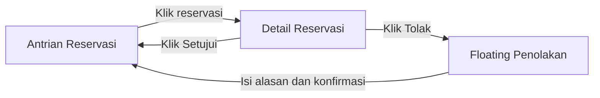
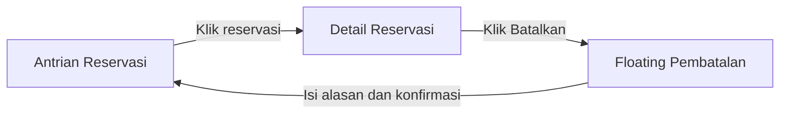
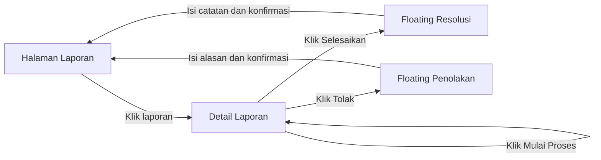
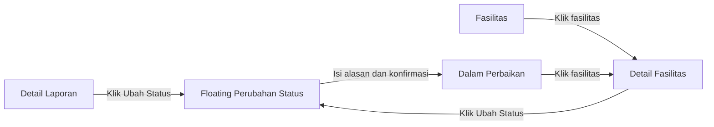
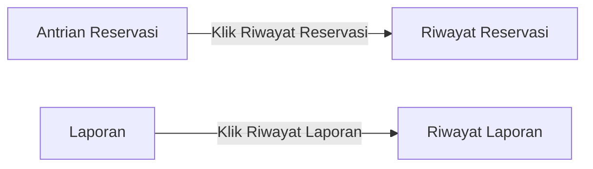

# SRS Petugas — PPK Room Reservation

**Status dokumen:** Draf untuk ditinjau

**Aktor:** Petugas yang telah login

## 1. Tujuan dan cakupan

Dokumen ini menjabarkan kebutuhan Petugas berdasarkan User Story 8–12 pada `CASE.md`, keputusan dalam `KEPUTUSAN-GLOBAL.md`, dan aturan reservasi serta laporan pada `SRS-PENGGUNA.md`.

Pada antarmuka, ruang, lapangan, laboratorium, dan alat disebut **Fasilitas**. Semuanya mengikuti satu alur reservasi tanpa stok, penyerahan, atau pengembalian alat.

Petugas dapat memproses semua fasilitas, reservasi, dan laporan. Tidak ada penugasan eksklusif Petugas terhadap fasilitas atau laporan. Sistem mencatat pelaku setiap tindakan untuk audit, tetapi Petugas lain tetap dapat melanjutkan penanganan.

## 2. Batas kewenangan

Petugas dapat:

- Melihat antrian reservasi dan seluruh laporan.
- Menyetujui atau menolak pengajuan reservasi `Menunggu`.
- Membatalkan reservasi `Disetujui` yang belum dimulai dalam keadaan mendesak.
- Memulai proses, menyelesaikan, atau menolak laporan sesuai transisi status.
- Melihat daftar fasilitas `Dalam perbaikan`.
- Mengubah status operasional fasilitas antara `Dapat digunakan` dan `Dalam perbaikan`.

Petugas tidak dapat:

- Menambah, mengedit, menonaktifkan, atau mengaktifkan kembali data master fasilitas.
- Membuat atau memverifikasi akun.
- Mengubah reservasi atau laporan yang telah berstatus final menjadi status sebelumnya.
- Menyetujui reservasi yang bentrok atau terhadap fasilitas `Dalam perbaikan`.

## 3. Kebutuhan fungsional

### FR-PTG-01 — Login dan navigasi kerja

Petugas login menggunakan akun yang dibuat Admin atau tersedia melalui seeding awal. Setelah login, Petugas langsung diarahkan ke **Antrian Reservasi**.

Navigasi Petugas memisahkan:

- **Antrian Reservasi**.
- **Riwayat Reservasi**.
- **Laporan**.
- **Riwayat Laporan**.
- **Fasilitas**.
- **Dalam Perbaikan**.

Sistem tidak memerlukan Homepage statistik atau dashboard terpisah. Petugas dapat logout; sesi autentikasi harus diakhiri.

### FR-PTG-02 — Melihat antrian dan detail reservasi

Halaman Antrian Reservasi menampilkan reservasi yang belum final: `Menunggu`, `Disetujui`, dan `Berlangsung`. Grup `Menunggu` berada paling atas. Di dalam setiap grup, waktu pengajuan paling lama ditampilkan terlebih dahulu. Setiap entri minimal menunjukkan nomor reservasi, pemohon, fasilitas, tanggal, waktu mulai dan selesai, status, serta waktu pengajuan.

Di kiri atas daftar tersedia satu pencarian berdasarkan nama pemohon **atau** nama fasilitas. Di kanan atas tersedia filter tipe fasilitas dan status reservasi. Pencarian dan filter dapat digunakan bersamaan. Petugas dapat membuka Detail Reservasi untuk melihat tujuan penggunaan dan status terbaru.

Reservasi dengan status final `Selesai`, `Ditolak`, `Dibatalkan oleh pengguna`, `Dibatalkan oleh petugas`, atau `Kedaluwarsa` tidak ditampilkan dalam antrian, tetapi dapat dilihat pada halaman **Riwayat Reservasi** melalui navigasi tersendiri. Riwayat mempunyai pencarian dan filter yang sama, dengan pilihan status final. Urutan bawaan mengikuti waktu pengajuan tertua ke terbaru. Pemindahan ini adalah pengelompokan tampilan, bukan pemindahan atau penghapusan data.

### FR-PTG-03 — Menyetujui reservasi

Petugas dapat menyetujui reservasi yang masih `Menunggu` hanya sebelum waktu mulai. Tepat saat waktu mulai tercapai, pengajuan `Menunggu` menjadi `Kedaluwarsa` dan tidak dapat disetujui.

Saat persetujuan dikonfirmasi, sistem harus memeriksa status terbaru, memastikan data master fasilitas masih aktif dan status operasionalnya `Dapat digunakan`, memeriksa aturan waktu, serta memeriksa bentrokan dengan reservasi `Disetujui` atau `Berlangsung` pada fasilitas yang sama. Pemeriksaan dan perubahan status harus aman terhadap tindakan Petugas lain maupun penonaktifan oleh Admin yang berlangsung bersamaan.

Jika valid, reservasi menjadi `Disetujui`. Pengajuan `Menunggu` lain yang bertabrakan pada fasilitas dan rentang waktu tersebut menjadi `Ditolak` secara otomatis dengan alasan sistem bahwa jadwal sudah diberikan kepada pengajuan lain. Jika validasi gagal, persetujuan tidak dilakukan dan Petugas melihat penyebabnya.

### FR-PTG-04 — Menolak reservasi

Petugas dapat menolak reservasi `Menunggu` secara manual sebelum waktu mulai dengan mengisi alasan wajib. Status menjadi `Ditolak` dan bersifat final: detail masih dapat dilihat, tetapi status tidak dapat dikembalikan ke `Menunggu` atau diubah menjadi `Disetujui`. Pada atau setelah waktu mulai, pengajuan yang belum diproses adalah `Kedaluwarsa`, bukan sasaran penolakan manual.

### FR-PTG-05 — Membatalkan reservasi mendesak

Petugas dapat membatalkan reservasi `Disetujui` yang belum mencapai waktu mulai jika terdapat keadaan mendesak. Petugas wajib mengisi alasan berupa teks bebas; sistem tidak meminta kategori alasan. Status menjadi `Dibatalkan oleh petugas` dan sistem menyimpan pelaku serta waktu tindakan.

Reservasi yang sudah `Berlangsung`, `Selesai`, `Ditolak`, `Kedaluwarsa`, atau telah dibatalkan tidak dapat dibatalkan melalui aksi ini.

### FR-PTG-06 — Melihat daftar dan detail laporan

Halaman Laporan hanya menampilkan laporan yang belum final, yaitu `Baru` dan `Diproses`. Grup `Baru` berada paling atas. Di dalam setiap grup, laporan yang paling lama dikirim ditampilkan terlebih dahulu. Setiap entri minimal menunjukkan nomor laporan, pelapor, fasilitas, kategori, tanggal, dan status.

Di kiri atas daftar tersedia satu pencarian berdasarkan nama pelapor **atau** nama fasilitas. Di kanan atas tersedia filter tipe fasilitas dan status laporan. Pencarian dan filter dapat digunakan bersamaan.

Laporan `Selesai` dan `Ditolak` ditampilkan pada halaman **Riwayat Laporan** melalui navigasi tersendiri. Riwayat mempunyai pencarian dan filter yang sama, dengan pilihan status final. Urutan bawaan mengikuti waktu pengiriman tertua ke terbaru. Pengelompokan ini tidak menghapus data laporan.

Detail Laporan menampilkan pelapor, fasilitas, kategori, deskripsi, foto jika ada, status, catatan resolusi atau alasan penolakan, serta riwayat tindakan Petugas.

### FR-PTG-07 — Memulai proses laporan

Petugas dapat memilih **Mulai Proses** pada laporan `Baru`. Status berubah menjadi `Diproses`; sistem mencatat Petugas dan waktu tindakan.

Pencatatan pelaku tidak membuat laporan menjadi milik eksklusif Petugas tersebut. Petugas lain tetap dapat melihat dan menindaklanjutinya.

### FR-PTG-08 — Menyelesaikan laporan

Petugas dapat mengubah laporan `Diproses` menjadi `Selesai` setelah mengisi catatan resolusi wajib. Status `Selesai` bersifat final.

Penyelesaian laporan tidak otomatis mengembalikan fasilitas `Dalam perbaikan` menjadi `Dapat digunakan`; perubahan status operasional merupakan tindakan tersendiri yang memerlukan catatan pemeriksaan atau perbaikan.

### FR-PTG-09 — Menolak laporan

Petugas dapat mengubah laporan `Diproses` menjadi `Ditolak` dengan alasan wajib. Penolakan langsung dari `Baru` tidak diperbolehkan; Petugas harus memilih **Mulai Proses** terlebih dahulu. Status `Ditolak` bersifat final.

### FR-PTG-10 — Menandai fasilitas dalam perbaikan

Petugas dapat mengubah fasilitas `Dapat digunakan` menjadi `Dalam perbaikan` dari Detail Laporan atau Detail Fasilitas. Petugas wajib mengisi alasan. Jika tindakan dimulai dari Detail Laporan, laporan harus berstatus `Diproses` dan sistem mencatatnya sebagai sumber perubahan. Perubahan langsung dari Detail Fasilitas tidak mewajibkan laporan sumber.

Saat perubahan berhasil, sistem harus pada proses yang konsisten:

- Menolak seluruh pengajuan yang masih `Menunggu` sebelum waktu mulai pada fasilitas tersebut dengan alasan perubahan status fasilitas. Pengajuan yang sudah mencapai waktu mulai mengikuti aturan `Kedaluwarsa`.
- Membatalkan seluruh reservasi `Disetujui` yang belum dimulai dengan status `Dibatalkan oleh petugas` dan alasan yang sama.
- Membiarkan reservasi `Berlangsung` berjalan hingga waktunya selesai; tidak ada pembatalan otomatis.
- Menolak pengajuan reservasi baru selama status operasional masih `Dalam perbaikan`.

### FR-PTG-11 — Mengembalikan fasilitas ke status dapat digunakan

Petugas dapat mengubah fasilitas `Dalam perbaikan` menjadi `Dapat digunakan` setelah pemeriksaan atau perbaikan selesai. Catatan pemeriksaan atau perbaikan wajib diisi. Jika tindakan berasal dari Detail Laporan, laporan harus masih `Diproses` dan dicatat sebagai sumber perubahan. Laporan yang sudah final tidak dibuka kembali; Petugas tetap dapat melakukan perubahan status melalui Detail Fasilitas.

Perubahan ini tidak menghidupkan kembali pengajuan yang telah `Ditolak` atau reservasi yang telah `Dibatalkan oleh petugas`. Pengguna perlu mengajukan reservasi baru.

### FR-PTG-12 — Melihat fasilitas dalam perbaikan

Halaman **Dalam Perbaikan** menampilkan seluruh fasilitas dengan status operasional `Dalam perbaikan`, termasuk nama, tipe, lokasi, alasan terakhir, waktu perubahan, dan Petugas pelaku. Di kiri atas tersedia pencarian nama fasilitas dan di kanan atas filter tipe. Filter status tidak diperlukan karena seluruh entri sudah berstatus `Dalam perbaikan`. Petugas dapat membuka Detail Fasilitas untuk meninjau status dan mengembalikannya menjadi `Dapat digunakan`.

### FR-PTG-13 — Melihat daftar fasilitas kerja

Halaman **Fasilitas** menampilkan seluruh fasilitas kepada Petugas, termasuk yang `Dapat digunakan`, `Dalam perbaikan`, aktif, dan nonaktif sebagai data master. Daftar minimal menunjukkan nama, tipe, lokasi, status operasional, dan status aktif/nonaktif data. Petugas dapat mencari berdasarkan nama, memfilter tipe, serta membuka Detail Fasilitas. Halaman ini menyediakan jalan ke Detail Fasilitas `Dapat digunakan` ketika Petugas perlu menandainya `Dalam perbaikan` tanpa laporan sumber. Petugas tetap tidak dapat mengubah data master.

## 4. Aturan bisnis

### BR-PTG-01 — Akses lintas fasilitas

- Semua Petugas dapat menangani semua fasilitas, reservasi, dan laporan.
- Banyak Petugas dapat menangani fasilitas yang sama dan satu Petugas dapat menangani banyak fasilitas.
- Tidak diperlukan relasi penugasan eksklusif Petugas–fasilitas untuk memenuhi user story.
- Setiap perubahan menyimpan identitas Petugas pelaku dan waktu tindakan.
- Setiap permintaan perubahan divalidasi terhadap status terbaru di server agar tindakan bersamaan tidak menghasilkan transisi yang saling bertentangan.

### BR-PTG-02 — Status reservasi

- Petugas memproses `Menunggu` menjadi `Disetujui` atau `Ditolak`.
- Penolakan manual memerlukan alasan.
- Reservasi yang sudah `Ditolak` tidak dapat dibuka kembali untuk diproses, tetapi detailnya tetap dapat dilihat.
- Pengajuan `Menunggu` yang belum diproses tepat saat waktu mulai tercapai menjadi `Kedaluwarsa`.
- Persetujuan dan penolakan manual hanya boleh dilakukan ketika waktu saat permintaan diproses di server masih sebelum waktu mulai, meskipun pembaruan status terjadwal belum berjalan.
- `Disetujui` berubah menjadi `Berlangsung` ketika waktu mulai tercapai dan menjadi `Selesai` setelah waktu selesai.
- Petugas hanya dapat membatalkan `Disetujui` sebelum waktu mulai karena keadaan mendesak, dengan alasan wajib.

### BR-PTG-03 — Persetujuan dan bentrokan

- Pengajuan `Menunggu` tidak mengunci jadwal.
- Persetujuan hanya berlaku jika data master fasilitas aktif, status operasional `Dapat digunakan`, dan tidak ada reservasi `Disetujui` atau `Berlangsung` yang bertabrakan pada fasilitas yang sama.
- Pemeriksaan bentrokan dan perubahan status harus dilakukan secara atomik agar dua Petugas tidak dapat menyetujui jadwal yang sama secara bersamaan atau menyetujui tepat ketika Admin menonaktifkan fasilitas.
- Setelah satu pengajuan disetujui, pengajuan `Menunggu` lain yang bertabrakan otomatis menjadi `Ditolak` dengan alasan sistem.

### BR-PTG-04 — Transisi laporan

```text
Baru → Diproses → Selesai
                 → Ditolak
```

- `Baru → Diproses` dilakukan melalui **Mulai Proses**.
- `Diproses → Selesai` memerlukan catatan resolusi.
- `Diproses → Ditolak` memerlukan alasan penolakan.
- `Baru → Ditolak` tidak diperbolehkan.
- `Selesai` dan `Ditolak` adalah status final.
- Status laporan tidak otomatis berubah ketika status operasional fasilitas berubah.

### BR-PTG-05 — Status operasional dan dampak reservasi

- Perubahan `Dapat digunakan → Dalam perbaikan` memerlukan alasan dan memicu dampak pada pengajuan serta reservasi fasilitas yang sama sesuai FR-PTG-10.
- Perubahan `Dalam perbaikan → Dapat digunakan` memerlukan catatan pemeriksaan atau perbaikan dan tidak membalik status transaksi yang sudah final.
- Perubahan status operasional dan dampaknya terhadap reservasi harus diproses konsisten, tanpa meninggalkan reservasi mendatang yang masih `Disetujui` pada fasilitas `Dalam perbaikan`.
- Status `Dalam perbaikan` memblokir reservasi baru untuk tanggal apa pun.

### BR-PTG-06 — Pemisahan kewenangan Admin

Petugas mengubah status operasional `Dapat digunakan` dan `Dalam perbaikan`. Admin mengelola data master fasilitas, termasuk menambah, mengedit nama/tipe/lokasi/kapasitas, menonaktifkan, dan mengaktifkan kembali data. Status aktif/nonaktif data master berbeda dari status operasional.

Penonaktifan oleh Admin diblokir bila masih ada reservasi `Disetujui` atau `Berlangsung`. Jika penonaktifan berhasil, pengajuan yang masih `Menunggu` sebelum waktu mulai menjadi `Ditolak` otomatis dengan alasan fasilitas dinonaktifkan dan tidak lagi muncul di Antrian Reservasi; riwayatnya tetap tersedia. Pengajuan yang sudah mencapai waktu mulai menjadi `Kedaluwarsa` menurut aturan waktu. Penolakan otomatis ini bukan tindakan manual Petugas.

### BR-PTG-07 — Pemisahan antrian dan riwayat

- Reservasi aktif `Menunggu`, `Disetujui`, dan `Berlangsung` berada pada Antrian Reservasi. Status `Menunggu` ditampilkan lebih dahulu; dalam setiap grup status, urutan mengikuti waktu pengajuan tertua ke terbaru.
- Reservasi final `Selesai`, `Ditolak`, `Dibatalkan oleh pengguna`, `Dibatalkan oleh petugas`, dan `Kedaluwarsa` berada pada Riwayat Reservasi.
- Riwayat Reservasi diurutkan berdasarkan waktu pengajuan tertua ke terbaru.
- Laporan aktif `Baru` dan `Diproses` berada pada Laporan. Status `Baru` ditampilkan lebih dahulu; dalam setiap grup status, urutan mengikuti waktu pengiriman tertua ke terbaru.
- Laporan final `Selesai` dan `Ditolak` berada pada Riwayat Laporan.
- Riwayat Laporan diurutkan berdasarkan waktu pengiriman tertua ke terbaru.
- Perpindahan ke Riwayat terjadi karena perubahan status, tanpa memindahkan record ke penyimpanan data lain.
- Pencarian dan filter tidak mengubah status ataupun urutan prioritas default pada antrian.

## 5. Validasi dan data audit

Field wajib menurut tindakan:

| Tindakan | Field wajib |
|---|---|
| Menolak reservasi | Alasan penolakan |
| Membatalkan reservasi mendesak | Alasan pembatalan |
| Menyelesaikan laporan | Catatan resolusi |
| Menolak laporan | Alasan penolakan |
| Menandai `Dalam perbaikan` | Alasan perubahan |
| Mengembalikan `Dapat digunakan` | Catatan pemeriksaan atau perbaikan |

Sistem menyimpan objek yang berubah, status sebelum dan sesudah, pelaku, waktu, alasan atau catatan, serta laporan sumber jika perubahan berasal dari laporan. Form keputusan dan perubahan status memberi validasi isian serta umpan balik di sisi klien. Semua validasi status, kewenangan, dan isian wajib diulang di server.

## 6. Flow Petugas

Node menunjukkan halaman atau floating window. Edge menunjukkan tindakan Petugas, bukan perubahan status otomatis oleh sistem.

### 6.1 Memproses reservasi



Persetujuan hanya berhasil setelah pemeriksaan bentrokan dan status fasilitas di server.

### 6.2 Membatalkan reservasi mendesak



### 6.3 Memproses laporan



Aksi **Selesaikan** dan **Tolak** hanya tersedia ketika laporan `Diproses`.

### 6.4 Mengubah status operasional fasilitas



Floating yang sama digunakan untuk menandai `Dalam perbaikan` atau mengembalikan `Dapat digunakan`, dengan label field sesuai tindakan.

### 6.5 Membuka riwayat



Riwayat berisi status final dan tetap dapat dibuka untuk melihat detail, tetapi tidak untuk mengulang keputusan yang sudah final.

## 7. Tabel akses, informasi, dan halaman

| Aktor | Informasi yang dapat dilihat | Aksi yang dapat dilakukan | Halaman yang dapat diakses | Penamaan `.blade.php` |
|---|---|---|---|---|
| Petugas | Form autentikasi | Login | Login bersama | `auth/login.blade.php` |
| Petugas | Reservasi aktif `Menunggu`, `Disetujui`, dan `Berlangsung` | Mencari nama pemohon/fasilitas, memfilter tipe/status, dan membuka detail | Antrian Reservasi — halaman awal | `staff/reservations/index.blade.php` |
| Petugas | Reservasi final `Selesai`, `Ditolak`, `Dibatalkan oleh pengguna/petugas`, dan `Kedaluwarsa` | Mencari, memfilter, dan membuka detail tanpa memproses ulang | Riwayat Reservasi | `staff/reservations/history.blade.php` |
| Petugas | Data lengkap reservasi, tujuan, status, dan alasan terkait | Menyetujui, menolak, atau membatalkan sesuai status | Detail Reservasi | `staff/reservations/show.blade.php` |
| Petugas | Form alasan penolakan | Menolak reservasi `Menunggu` | Detail Reservasi — **floating window Penolakan** | `staff/reservations/show.blade.php` dengan partial `staff/reservations/partials/reject-modal.blade.php` |
| Petugas | Form alasan pembatalan | Membatalkan reservasi `Disetujui` sebelum mulai | Detail Reservasi — **floating window Pembatalan** | `staff/reservations/show.blade.php` dengan partial `staff/reservations/partials/cancel-modal.blade.php` |
| Petugas | Laporan aktif `Baru` dan `Diproses` | Mencari nama pelapor/fasilitas, memfilter tipe/status, dan membuka detail | Laporan | `staff/reports/index.blade.php` |
| Petugas | Laporan final `Selesai` dan `Ditolak` | Mencari, memfilter, dan membuka detail tanpa memproses ulang | Riwayat Laporan | `staff/reports/history.blade.php` |
| Petugas | Data laporan, foto, status, dan riwayat tindakan | Memulai proses, membuka resolusi/penolakan, atau mengubah status fasilitas | Detail Laporan | `staff/reports/show.blade.php` |
| Petugas | Form catatan resolusi atau alasan penolakan | Menyelesaikan atau menolak laporan `Diproses` | Detail Laporan — **floating window** | `staff/reports/show.blade.php` dengan partial `staff/reports/partials/decision-modal.blade.php` |
| Petugas | Daftar fasilitas `Dalam perbaikan` dan alasan terakhir | Mencari nama fasilitas, memfilter tipe, dan membuka Detail Fasilitas | Dalam Perbaikan | `staff/facilities/maintenance.blade.php` |
| Petugas | Seluruh fasilitas beserta status operasional dan aktif/nonaktif data | Mencari nama, memfilter tipe, dan membuka Detail Fasilitas | Fasilitas | `staff/facilities/index.blade.php` |
| Petugas | Data fasilitas dan status operasional | Membuka perubahan status | Detail Fasilitas | `staff/facilities/show.blade.php` |
| Petugas | Form alasan atau catatan pemeriksaan | Mengubah status operasional fasilitas | Detail Laporan atau Detail Fasilitas — **floating window Perubahan Status** | Halaman induk masing-masing dengan partial `staff/facilities/partials/status-modal.blade.php` |

## 8. Kesesuaian dengan user story

- User Story 8 dipenuhi oleh Antrian Reservasi, Laporan, dan Dalam Perbaikan, dengan Riwayat Reservasi serta Riwayat Laporan terpisah agar antrian tidak menumpuk. Tidak ada statistik yang diwajibkan.
- User Story 9 dipenuhi oleh persetujuan/penolakan manual dan pencegahan persetujuan bentrok.
- User Story 10 dipenuhi oleh pembatalan mendesak dengan alasan wajib.
- User Story 11 dipenuhi oleh transisi laporan `Baru → Diproses → Selesai/Ditolak` dengan catatan resolusi atau alasan.
- User Story 12 dipenuhi oleh perubahan status operasional fasilitas berdasarkan pemeriksaan laporan dan pemulihan setelah perbaikan.
- User Story 16 menetapkan pengelolaan data master kepada Admin, bukan Petugas.
